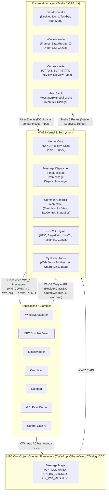

# 🪟 win32-svelte

> **"Why write modern reactive components when you can register a `WNDCLASSEX` and write a 1995-era `WndProc` switch statement in TypeScript?"**

`win32-svelte` is a faithful, playful, and architecturally serious re-implementation of the classic **Win32 API** (Handles, Window Classes, Message Loop, GDI, Controls, Dialogs, Web Audio Sound Blaster/PC-speaker synthesizers) running on top of **Svelte 5** and styled with **98.css**.

---

Demo here: https://win32-svelte.vercel.app/


---

## 🎨 The Playful Motivation

The modern web development world is awash with reactive signals, virtual DOM diffing, JSX transforms, server components, and hydration boundaries. But decades before modern front-end frameworks existed, software engineers built rock-solid, highly responsive GUI software using a remarkably enduring architecture: **The Win32 User & GDI subsystem**.

This project asks a delightfully absurd question:

*What if Charles Petzold’s classic 1998 bible "Programming Windows" was written for the modern browser?*

Instead of abstracting the web, `win32-svelte` implements:
- Real `HWND` handles, parent-child hierarchies, and Z-indexing.
- `RegisterClassEx` and window procedure callbacks (`lpfnWndProc(hwnd, uMsg, wParam, lParam)`).
- Synchronous `SendMessage` and queued `PostMessage`.
- An asynchronous message loop pump (`GetMessage`, `TranslateMessage`, `DispatchMessage`).
- Classic standard controls (`BUTTON`, `EDIT`, `STATIC`, `COMBOBOX`, `MSCTLS_PROGRESS32`, `MSCTLS_TRACKBAR32`).
- A canvas-based GDI subsystem (`BeginPaint`, `MoveToEx`, `LineTo`, `Rectangle`, `Ellipse`, `TextOut`, `CreateSolidBrush`, `SelectObject`).
- Synthesized Windows 98 system sound effects (Chord, Ding, Chime, Tada) using the Web Audio API—no external `.wav` files needed!
- The authentic look and feel of Windows 98 via [98.css](https://jdan.github.io/98.css/).

It bridges the procedural, message-oriented mental model of C programming with the fine-grained reactivity of **Svelte 5 runes** (`$state`, `$derived`, `$effect`).

---

## 🚀 How to Run

### Prerequisites
- [Node.js](https://nodejs.org/) (version 18+ recommended)
- `npm` (or `pnpm` / `yarn`)

### Quick Start

```bash
# Clone the repository
git clone https://github.com/your-username/win32-svelte.git
cd win32-svelte

# Install dependencies
npm install

# Start the Vite development server
npm run dev
```

Open your browser at `http://localhost:5173` (or the URL displayed in your terminal).

### Available Scripts

| Script | Command | Purpose |
|---|---|---|
| `npm run dev` | `vite` | Starts local development server with Vite HMR |
| `npm run build` | `vite build` | Compiles the project to production-ready static assets in `dist/` |
| `npm run preview` | `vite preview` | Previews the built production app locally |
| `npm run check` | `svelte-check ... && tsc ...` | Typechecks Svelte components and TypeScript code |

### 🌐 Deploying to Vercel

You can deploy `win32-svelte` to Vercel with zero additional configuration:

[](https://vercel.com/new/clone?repository-url=https%3A%2F%2Fgithub.com%2Fnet-pilgrim%2Fwin32-svelte)

Or deploy using the [Vercel CLI](https://vercel.com/docs/cli):

```bash
# Deploy to preview
npx vercel

# Deploy to production
npx vercel --prod
```

The project includes a pre-configured [`vercel.json`](file:///home/dsv/work/win32-svelte/vercel.json) specifying the Vite framework build output (`dist/`) and SPA index routing.

### What You'll Experience
When the app opens:
1. **Windows 98 Desktop Environment**: Fully featured desktop with icons (*My Computer*, *Minesweeper*, *GDI Paint*, *Notepad*, *Calculator*, *Recycle Bin*), movable and resizable windows, taskbar with running tasks, Start button, and system tray clock.
2. **Preloaded Applications**: Launches *Minesweeper* and *GDI Paint Demo* by default.
3. **Debug HUD & HWND Inspector**:
   - Quick-spawn buttons in the top-right corner.
   - Audio mute/unmute toggle.
   - **Inspect HWNDs**: An interactive live inspector showing the internal kernel handle table (`HWND`, parent, window class, text, and visibility).

---

## 🏛️ Architecture

`win32-svelte` is structured into three clean layers: the **Win32 Kernel Runtime**, the **GDI & Audio Engines**, and the **Svelte 5 Reactive Presentation Layer**.



### 1. The Kernel Subsystem (`src/win32/kernel.svelte.ts`)
The kernel acts as the operating system GUI manager:
- **Handle Allocation**: Assigns unique numeric handles (`HWND` starting at 100, `HMENU` starting at 500).
- **Window Class Registry (`RegisterClassEx`)**: Stores window classes with their associated `lpfnWndProc`. Built-in system classes (`BUTTON`, `EDIT`, `STATIC`, `COMBOBOX`, `MSCTLS_PROGRESS32`, `MSCTLS_TRACKBAR32`) are pre-registered on boot.
- **Message Dispatching**:
  - `SendMessage(hwnd, msg, wParam, lParam)`: Synchronously invokes the target window's `WndProc` and returns an `LRESULT`.
  - `PostMessage(hwnd, msg, wParam, lParam)`: Enqueues messages asynchronously.
  - `GetMessage(msg)`: Yields from the queue or awaits incoming posted messages.
  - `DispatchMessage(msg)`: Dispatches queued messages to their window procedures.
  - `RunMessageLoop()`: Standard message loop helper:
    ```typescript
    while (await GetMessage(msg)) {
      TranslateMessage(msg);
      DispatchMessage(msg);
    }
    ```
- **Hierarchical Menus**: `CreateMenu`, `CreatePopupMenu`, `AppendMenu`, `SetMenu`, `CheckMenuItem`, `EnableMenuItem`.
- **Timers**: `SetTimer` and `KillTimer` dispatches `WM_TIMER` through the message queue.
- **Modal Dialogs**: `MessageBox(hwnd, text, caption, type)` suspends via a Promise until the user clicks OK, Yes, No, or Cancel.
- **Shell Drag & Drop (`shell32`)**:
  - `DragAcceptFiles(hwnd, fAccept)`: Registers windows for file drops (`WS_EX_ACCEPTFILES`).
  - `WM_DROPFILES`: Dispatched with `HDROP` containing dropped file metadata and text content.
  - `DragQueryFile(hDrop, iFile)` & `DragQueryPoint(hDrop, lpPoint)` & `DragFinish(hDrop)`.
  - Seamlessly bridges native host OS file drag-and-drop (`.txt`, `.js`, etc.) and internal app-to-app dragging (e.g., from Windows Explorer to Notepad or Recycle Bin).

### 2. GDI 2D Graphics Engine (`src/win32/gdi.ts`)
Encapsulates HTML5 `<canvas>` rendering within standard Win32 Device Context (`HDC`) semantics:
- `BeginPaint(hwnd, ps)` / `EndPaint(hwnd, ps)`
- `MoveToEx(hdc, x, y)` & `LineTo(hdc, x, y)`
- `Rectangle(hdc, left, top, right, bottom)`
- `Ellipse(hdc, left, top, right, bottom)`
- `TextOut(hdc, x, y, text)` & `SetTextColor(hdc, color)`
- `CreateSolidBrush(color)` & `CreatePen(style, width, color)`
- `SelectObject(hdc, hGdiObj)`
- `InvalidateRect(hwnd, rect, erase)`: Triggers a fresh `WM_PAINT` message.

### 3. Web Audio Sound Engine (`src/win32/audio.ts`)
Uses Web Audio API oscillators and gain envelopes to synthesize legendary retro OS sounds in real time:
- `playChord()`: Minor-major chord cluster for `MB_ICONERROR` / Critical Stop.
- `playDing()`: Resonant sine sweep for `MB_ICONWARNING` / Exclamation.
- `playChime()`: Ascending glockenspiel bell tones for `MB_ICONINFORMATION` / Asterisk.
- `playTada()`: Fanfare brass synth for victories / startup.
- `MessageBeep(type)`: Standard Win32 sound dispatcher.

### 4. Microsoft Foundation Classes (MFC) Layer (`src/win32/mfc/`)
A pure object-oriented C++ simulation layer mirroring classic MFC:
- **`CObject`**: Root class providing runtime class information and `isKindOf()` type introspection.
- **`CCmdTarget`**: Message map dispatcher routing `WM_COMMAND`, `WM_NOTIFY`, and window messages via `ON_COMMAND`, `ON_BN_CLICKED`, `ON_EN_CHANGE`, and `ON_NOTIFY`.
- **`CWnd`**: Complete object-oriented window wrapper managing `m_hWnd`, `FromHandle()`, and message routing.
- **`CFrameWnd`**: Top-level single-document interface (SDI) frame windows with menu bar management.
- **`CDialog`**: Modal and modeless dialog architecture with `doModal()`, `onInitDialog()`, `onOK()`, and `onCancel()`.
- **`CWinApp`**: Application singleton managing initialization (`initInstance`), main window binding (`m_pMainWnd`), and exit teardown.
- **`CDC` & `CPaintDC`**: Device context wrappers providing clean object-oriented GDI drawing (`MoveTo`, `LineTo`, `Rectangle`, `Ellipse`, `TextOut`).
- **Control Wrappers**: `CButton`, `CEdit`, `CStatic`, `CComboBox`, `CProgressCtrl`, `CSliderCtrl`, `CTreeCtrl`, `CListCtrl`.

### 5. Svelte 5 UI Bridge (`src/win32/ui/`)
- **[Desktop.svelte](file:///home/dsv/work/win32-svelte/src/win32/ui/Desktop.svelte)**: Manages desktop background, icons, running window taskbar entries, system time, and modal overlays.
- **[Window.svelte](file:///home/dsv/work/win32-svelte/src/win32/ui/Window.svelte)**: Renders the active/inactive window frame, title bar controls, handles dragging/resizing, and mounts `<canvas>` for GDI windows.
- **[Control.svelte](file:///home/dsv/work/win32-svelte/src/win32/ui/Control.svelte)**: Maps child `HWND`s to DOM elements based on window style bitmasks (`BS_AUTOCHECKBOX`, `BS_AUTORADIOBUTTON`, `ES_MULTILINE`, `CBS_DROPDOWN`, etc.).
- **[MenuBar.svelte](file:///home/dsv/work/win32-svelte/src/win32/ui/MenuBar.svelte)**: Handles top-level menu strips, dropdown popups, separators, shortcuts, and sends `WM_COMMAND` with menu IDs.
- **[MessageBoxModal.svelte](file:///home/dsv/work/win32-svelte/src/win32/ui/MessageBoxModal.svelte)**: Faithful reproduction of the classic Windows 98 message box dialog with icons.

---

## 🕹️ Sample Applications

The project includes seven complete sample applications:

| App | File | Features Demonstrated |
|---|---|---|
| **MFC Scribble** | [`src/samples/mfc_demo.ts`](file:///home/dsv/work/win32-svelte/src/samples/mfc_demo.ts) | Object-oriented **MFC** architecture! `CWinApp` lifecycle, `CFrameWnd` frame, `createMessageMap()` command routing, `CPaintDC` GDI rendering, `CButton` and `CProgressCtrl` child controls, and modal `CDialog::doModal()`. |
| **Windows Explorer** | [`src/samples/explorer.ts`](file:///home/dsv/work/win32-svelte/src/samples/explorer.ts) | The flagship **`comctl32`** showcase! Left-pane `SysTreeView32` folder hierarchy, right-pane `SysListView32` in report/details mode with multi-column sorting & selection, two-part `msctls_statusbar32`, cascading menu commands, and `WM_NOTIFY` (`TVN_SELCHANGED`, `LVN_ITEMCHANGED`) event routing. |
| **Minesweeper** | [`src/samples/minesweeper.ts`](file:///home/dsv/work/win32-svelte/src/samples/minesweeper.ts) | 81 child button controls, right-click `BN_RIGHTCLICK` flagging, `SetTimer` game clock, custom 7-segment LED numbers, reset smiley button, win/loss fanfare sound. |
| **GDI Paint** | [`src/samples/paint_demo.ts`](file:///home/dsv/work/win32-svelte/src/samples/paint_demo.ts) | Interactive freehand drawing on canvas, GDI geometry primitives (`Rectangle`, `Ellipse`, `LineTo`), menu color palettes, clear canvas command. |
| **Calculator** | [`src/samples/calculator.ts`](file:///home/dsv/work/win32-svelte/src/samples/calculator.ts) | Grid of button controls sending `WM_COMMAND`, `EDIT` display control updating via `SetWindowText`, arithmetic state machine. |
| **Notepad** | [`src/samples/notepad.ts`](file:///home/dsv/work/win32-svelte/src/samples/notepad.ts) | Multiline `EDIT` control with automatic resize on `WM_SIZE`, cascading *File*, *Edit*, and *Help* menus, *Time/Date* insertion, *Select All*, *About* dialog. |
| **Control Gallery** | [`src/samples/control_gallery.ts`](file:///home/dsv/work/win32-svelte/src/samples/control_gallery.ts) | Tabbed display properties featuring `SysTabControl32` (`TCM_INSERTITEM`, `TCN_SELCHANGE`), GroupBoxes, Checkboxes, Radio button groups, Progress bar stepping, Slider / Trackbar scrubbing, Combobox dropdowns, and Message Box triggers. |

### How Writing an App Looks

```typescript
import { RegisterClassEx, CreateWindowEx, ShowWindow, DefWindowProc } from "./win32/kernel.svelte";
import { WM_CREATE, WM_COMMAND, WS_OVERLAPPEDWINDOW, WS_VISIBLE, WS_CHILD, SW_SHOW } from "./win32/constants";

function MyWndProc(hwnd, msg, wParam, lParam) {
  switch (msg) {
    case WM_CREATE:
      // Create a child button!
      CreateWindowEx(0, "BUTTON", "Click Me", WS_CHILD | WS_VISIBLE, 20, 20, 100, 26, hwnd, 101);
      return 0;

    case WM_COMMAND:
      if (wParam === 101) {
        MessageBox(hwnd, "Hello from Win32 Svelte!", "Notice");
      }
      return 0;

    default:
      return DefWindowProc(hwnd, msg, wParam, lParam);
  }
}

RegisterClassEx({ className: "MyWindowClass", lpfnWndProc: MyWndProc });
const hwnd = CreateWindowEx(0, "MyWindowClass", "Sample Window", WS_OVERLAPPEDWINDOW, 100, 100, 300, 200);
ShowWindow(hwnd, SW_SHOW);
```

#### Writing an App in MFC Style (CWinApp + CFrameWnd + Message Maps)

```typescript
import { CWinApp, CFrameWnd, CPaintDC, createMessageMap, ON_COMMAND, ON_WM_MESSAGE } from "./win32/mfc";
import { WM_PAINT } from "./win32/constants";

class CMainFrame extends CFrameWnd {
  protected override getMessageMap() {
    return createMessageMap(
      undefined,
      ON_WM_MESSAGE(WM_PAINT, "OnPaint"),
      ON_COMMAND(101, "OnButtonClicked")
    );
  }

  public OnPaint(): void {
    const dc = new CPaintDC(this);
    dc.rectangle(20, 20, 200, 100);
    dc.textOut(30, 40, "Hello from MFC CDC!");
    dc.dispose();
  }

  public OnButtonClicked(): void {
    this.messageBox("Button clicked via MFC message map!", "MFC Demo");
  }
}

class CMyApp extends CWinApp {
  public override async initInstance(): Promise<boolean> {
    const pFrame = new CMainFrame();
    pFrame.create(null, "MFC Application");
    pFrame.showWindow();
    return true;
  }
}

const app = new CMyApp();
app.run();
```

---

## 🚧 Open Points & Known Limitations

While the core runtime supports an impressive array of classic software patterns, several interesting areas remain open for expansion:

1. **Message Loop & JavaScript Concurrency**:
   - In native C Win32, `GetMessage` blocks the OS thread until a message arrives. In JavaScript's single-threaded event loop, blocking is impossible, so `GetMessage` is asynchronous (`Promise<boolean>`).
   - Modal loops (like nested `DialogBoxParam`) require non-blocking fiber-like orchestration or `async/await` coroutines.
2. **Coordinate Spaces & Non-Client Area Metrics**:
   - Currently, window widths and heights approximate client rectangles.
   - Full support for `GetClientRect`, `GetWindowRect`, `AdjustWindowRectEx`, and `ScreenToClient` is partially mocked.
3. **Common Controls (`COMCTL32`) Enhancements**:
   - `WC_TABCONTROL`, `WC_TREEVIEW`, `WC_LISTVIEW`, and `STATUSCLASSNAME` are now supported!
   - Future extensions: Image lists (`HIMAGELIST`), column reordering/sorting drag-drop in `SysListView32`, and TreeView in-place label editing (`TVM_EDITLABEL`).
4. **Keyboard Navigation & Accelerator Tables**:
   - `WS_TABSTOP` keyboard tabbing between controls.
   - Accelerators (`HACCEL`, `TranslateAccelerator`) for global hotkeys (e.g., `Ctrl+O`, `Ctrl+S`, `Alt+F4`).
   - Mnemonic underline navigation (`Alt+F` for File menu).
5. **System Clipboard & OLE Data Transfer**:
   - Win32 Shell Drag & Drop (`DragAcceptFiles`, `WM_DROPFILES`, `DragQueryFile`) is now implemented!
   - Next steps: `OpenClipboard`, `EmptyClipboard`, `SetClipboardData`, and `GetClipboardData` bridged to the browser `navigator.clipboard` API, and OLE COM structured data transfer (`IDropTarget`, `IDropSource`).
6. **Custom Window Framing (`WM_NCPAINT`, `WM_NCHITTEST`)**:
   - Ability for user windows to perform custom non-client rendering and custom window shapes.

---

## 🔮 Possible Outcomes & Future Horizons

`win32-svelte` is more than a novelty; it is a foundation for several fascinating compilation and virtualization targets:

### 1. Resource Script (.rc) Compiler
Classic Windows applications separate UI layout from logic using `.rc` resource definition files:
```rc
IDD_ABOUTBOX DIALOGEX 0, 0, 170, 62
STYLE DS_MODALFRAME | WS_POPUP | WS_CAPTION | WS_SYSMENU
CAPTION "About Calculator"
FONT 8, "MS Sans Serif"
BEGIN
    ICON            IDI_APP,IDC_STATIC,14,14,20,20
    LTEXT           "Calculator Version 1.0",IDC_STATIC,42,14,114,8
    DEFPUSHBUTTON   "OK",IDOK,113,41,50,14,WS_GROUP
END
```
- **Vision**: Build an AST parser for `.rc` files that compiles directly into `win32-svelte` dialog templates (`CreateDialogParam` / `DialogBox`).
- **Outcome**: Take unmodified 1990s Windows dialog scripts and compile them straight into web GUI components without writing any HTML/CSS!

### 2. Transpilation & Compilation Target (C to WebAssembly)
- **Compiling Real Win32 C Code to Web**:
  - By writing a thin C header layer (`windows.h`) with Clang/Emscripten, legacy C Win32 applications could compile to WebAssembly and import their `user32.dll` and `gdi32.dll` symbols directly from this Svelte kernel.
  - Imagine compiling historical shareware, utilities, or classic demo code directly to modern web apps!
- **Transpiling Back to Native C**:
  - Since the TypeScript API strictly mirrors Win32 naming and calling conventions, a source-to-source transpiler or LLM-assisted pipeline could transpile TypeScript `win32-svelte` applications into ISO C99 targeting Microsoft Visual C++ or MinGW GCC to produce native `.exe` binaries.

### 3. Visual Basic 6.0 Runtime Bridge
- VB6 forms and controls map directly onto Win32 window handles and notification messages.
- A parser for `.frm` (VB Form) files could mount directly onto `win32-svelte` controls, reviving classic line-of-business forms in the browser.

### 4. Headless Automated UI Testing Harness
- Because the entire Win32 handle table and message queue live in memory independently of a physical desktop, entire suites of Win32 GUI tests can run in headless CI environments (`Node.js`) without needing a virtual display server (Xvfb / Wine).

See the [TODO & Roadmap](file:///home/dsv/work/win32-svelte/TODO.md) for detailed blueprints on remote container filesystem, printing, Winsock, and registry subsystems.

---

## 📜 License

This project is licensed under the **GNU Affero General Public License v3.0 (AGPL-3.0)**. See the [LICENSE](file:///home/dsv/work/win32-svelte/LICENSE) file for the full text.

Windows 98 styling is provided courtesy of [98.css](https://github.com/jdan/98.css) (MIT License).
