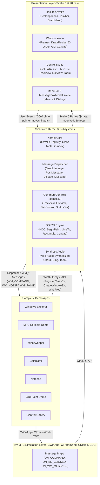

# 🪟 win32-svelte

> ⚠️ **Disclaimer:** This project is a playful, educational experiment and technical prototype exploring legacy Win32 operating system concepts in the browser. It is **not** a production-ready framework, complete emulation layer, or shippable product.

> *"Why write modern reactive components when you can register a `WNDCLASSEX` and write a 1995-era `WndProc` switch statement in TypeScript?"*

`win32-svelte` is an experimental prototype exploring classic **Win32 API** patterns (window handles, window classes, message loops, GDI primitives, basic dialogs, and synthesized retro sound effects) running on top of **Svelte 5** and styled with **98.css**.

---

Demo: https://win32-svelte.vercel.app/


---

## 🎨 The Motivation Behind the Experiment

The modern web development world is awash with reactive signals, virtual DOM diffing, JSX transforms, server components, and hydration boundaries. But decades before modern front-end frameworks existed, desktop software was built using a procedural, message-driven architecture: **The Win32 User & GDI subsystem**.

This project asks a playful question:

*What if Charles Petzold’s classic 1998 book "Programming Windows" was adapted as a toy experiment for the modern browser?*

Rather than following typical web patterns, `win32-svelte` experiments with:
- Simulated numeric `HWND` handles, parent-child hierarchies, and basic Z-ordering.
- A toy `RegisterClassEx` and window procedure callbacks (`lpfnWndProc(hwnd, uMsg, wParam, lParam)`).
- Synchronous `SendMessage` and queued `PostMessage`.
- An asynchronous message loop pump (`GetMessage`, `TranslateMessage`, `DispatchMessage`).
- Classic standard control wrappers (`BUTTON`, `EDIT`, `STATIC`, `COMBOBOX`, `MSCTLS_PROGRESS32`, `MSCTLS_TRACKBAR32`).
- A canvas-based GDI drawing prototype (`BeginPaint`, `MoveToEx`, `LineTo`, `Rectangle`, `Ellipse`, `TextOut`).
- **Experimental C WebAssembly Execution**: Compiling small C snippets targeting minimal `<windows.h>` header stubs into freestanding `.wasm` binaries that run within the browser prototype.
- Synthesized retro system sounds (Chord, Ding, Chime, Tada) using the Web Audio API without external audio files.
- Nostalgic Windows 98 aesthetics courtesy of [98.css](https://jdan.github.io/98.css/).

It explores bridging the procedural, message-oriented mental model of C programming with the fine-grained reactivity of **Svelte 5 runes** (`$state`, `$derived`, `$effect`).

---

## 🚀 Running the Prototype Locally

### Prerequisites
- [Node.js](https://nodejs.org/) (version 18+ recommended)
- `npm` (or `pnpm` / `yarn`)

### Quick Start

```bash
# Clone the repository
git clone https://github.com/your-username/win32-svelte.git
cd win32-svelte

# Install dependencies
npm install

# Start the Vite development server
npm run dev
```

Open your browser at `http://localhost:5173` (or the URL displayed in your terminal).

### Available Scripts

| Script | Command | Purpose |
|---|---|---|
| `npm run dev` | `vite` | Starts local development server with Vite HMR |
| `npm run build` | `vite build` | Compiles the prototype to static assets in `dist/` |
| `npm run preview` | `vite preview` | Previews the built static assets locally |
| `npm run check` | `svelte-check ... && tsc ...` | Typechecks Svelte components and TypeScript code |
| `npm test` | `tsx src/win32/__tests__/...` | Runs test suites (VFS, Print Spooler, ODBC, WASM Bridge, RC Compiler) |
| `npm run rc` | `tsx src/rc/cli.ts` | Compiles Win32 `.rc` resource scripts to TypeScript/JSON |
| `npm run build:wasm` | `tsx src/wasm/embed_wasm.ts` | Compiles C sample app to freestanding `.wasm` with Zig/Clang |

### Deploying to Vercel

The prototype can be deployed to Vercel as a static single-page application:

[](https://vercel.com/new/clone?repository-url=https%3A%2F%2Fgithub.com%2Fnet-pilgrim%2Fwin32-svelte)

The project includes a basic [`vercel.json`](file:///home/dsv/work/win32-svelte/vercel.json) specifying static output (`dist/`) and SPA routing.

### What's In The Demo

When the demo loads:
1. **Retro Desktop Sandbox**: Simulated desktop surface with movable and resizable windows, taskbar with active tasks, Start menu, desktop icons, and system tray clock.
2. **Preloaded Demo Apps**: Opens *Minesweeper* and *GDI Paint Demo* by default.
3. **Start Menu & Quick Launch**:
   - Windows 98-style **Start Menu** with *Programs* flyouts, *Documents*, *Settings*, sound toggle, and *Shut Down*.
   - **Taskbar Quick Launch Toolbar** with shortcuts for Explorer, WASM, Notepad, Paint, and Show Desktop (`🖥️`).
   - System tray clock and audio mute toggle (`🔊` / `🔇`).
   - **Inspect HWNDs**: A debugging inspector displaying the in-memory window handle table (`HWND`, parent, class, title, and visibility).

---

## 🏛️ Experimental Architecture

The prototype is organized into three exploratory layers: a simulated **Win32 Kernel**, helper **GDI & Audio Engines**, and a **Svelte 5 Presentation Layer**.



### 1. Simulated Kernel Subsystem (`src/win32/kernel.svelte.ts`)
The kernel acts as a lightweight in-memory GUI manager:
- **Handle Allocation**: Assigns incremental numeric handles (`HWND` starting at 100, `HMENU` starting at 500).
- **Window Class Registry (`RegisterClassEx`)**: Stores window classes with their associated `lpfnWndProc`. Built-in classes (`BUTTON`, `EDIT`, `STATIC`, `COMBOBOX`, `MSCTLS_PROGRESS32`, `MSCTLS_TRACKBAR32`) are pre-registered on startup.
- **Message Dispatching**:
  - `SendMessage(hwnd, msg, wParam, lParam)`: Synchronously invokes the window's `WndProc` and returns an `LRESULT`.
  - `PostMessage(hwnd, msg, wParam, lParam)`: Enqueues messages asynchronously.
  - `GetMessage(msg)`: Yields from the queue or awaits incoming posted messages.
  - `DispatchMessage(msg)`: Dispatches queued messages to their target window procedure.
  - `RunMessageLoop()`: Basic message loop helper:
    ```typescript
    while (await GetMessage(msg)) {
      TranslateMessage(msg);
      DispatchMessage(msg);
    }
    ```
- **Hierarchical Menus**: Toy implementation of `CreateMenu`, `CreatePopupMenu`, `AppendMenu`, and `SetMenu`.
- **Timers**: `SetTimer` and `KillTimer` dispatch `WM_TIMER` messages through the queue.
- **Modal Dialogs**: `MessageBox(hwnd, text, caption, type)` suspends via a Promise until the user dismisses the dialog.
- **Shell Drag & Drop (`shell32`)**:
  - Basic `DragAcceptFiles(hwnd, fAccept)` handling.
  - `WM_DROPFILES` dispatch with simulated `HDROP` metadata.
  - Simple bridge between host OS file drops and internal app-to-app dragging (e.g., from Explorer to Notepad).

### 2. GDI 2D Graphics Engine (`src/win32/gdi.ts`)
Encapsulates HTML5 `<canvas>` rendering within basic Win32 Device Context (`HDC`) function signatures:
- `BeginPaint(hwnd, ps)` / `EndPaint(hwnd, ps)`
- `MoveToEx(hdc, x, y)` & `LineTo(hdc, x, y)`
- `Rectangle(hdc, left, top, right, bottom)`
- `Ellipse(hdc, left, top, right, bottom)`
- `TextOut(hdc, x, y, text)` & `SetTextColor(hdc, color)`
- `CreateSolidBrush(color)` & `CreatePen(style, width, color)`
- `SelectObject(hdc, hGdiObj)`
- `InvalidateRect(hwnd, rect, erase)`: Triggers a `WM_PAINT` message.

### 3. Web Audio Sound Engine (`src/win32/audio.ts`)
Uses Web Audio API oscillators and gain envelopes to approximate retro sound effects in code:
- `playChord()`: Minor-major chord cluster for `MB_ICONERROR` / Critical Stop.
- `playDing()`: Resonant sweep for `MB_ICONWARNING` / Exclamation.
- `playChime()`: Glockenspiel bell tones for `MB_ICONINFORMATION` / Asterisk.
- `playTada()`: Fanfare brass synth for victories / startup.
- `MessageBeep(type)`: Simple sound dispatcher.

### 4. Toy MFC Layer (`src/win32/mfc/`)
A small TypeScript simulation exploring object-oriented MFC concepts:
- **`CObject`**: Base class providing simple runtime class information and `isKindOf()` checks.
- **`CCmdTarget`**: Message map dispatcher routing `WM_COMMAND`, `WM_NOTIFY`, and window messages via `ON_COMMAND`, `ON_BN_CLICKED`, `ON_EN_CHANGE`, and `ON_NOTIFY`.
- **`CWnd`**: Window wrapper managing `m_hWnd`, `FromHandle()`, and message routing.
- **`CFrameWnd`**: Top-level single-document interface (SDI) frame window helper.
- **`CDialog`**: Modal dialog prototype with `doModal()`, `onInitDialog()`, `onOK()`, and `onCancel()`.
- **`CWinApp`**: Application class managing initialization (`initInstance`) and main window binding (`m_pMainWnd`).
- **`CDC` & `CPaintDC`**: Device context wrappers providing GDI drawing methods (`MoveTo`, `LineTo`, `Rectangle`, `Ellipse`, `TextOut`).
- **Control Wrappers**: Minimal wrappers for `CButton`, `CEdit`, `CStatic`, `CComboBox`, `CProgressCtrl`, `CSliderCtrl`, `CTreeCtrl`, `CListCtrl`.

### 5. Experimental C WebAssembly Bridge (`include/` & `src/win32/wasm_bridge.ts`)
Enables running small C snippets compiled to WebAssembly inside the sandbox:
- **Minimal Header Stubs (`include/`)**: Self-contained stubs for [`windows.h`](include/windows.h), [`windef.h`](include/windef.h), [`winuser.h`](include/winuser.h), [`wingdi.h`](include/wingdi.h), and [`winbase.h`](include/winbase.h).
- **Freestanding Compilation**: Works with standard Zig (`zig cc`) or Clang targeting `wasm32-freestanding` without requiring libc.
- **Function Pointer Callbacks**: Window procedures (`WndProc`) are exported via `__indirect_function_table`, allowing the TypeScript dispatcher to invoke C function pointers when events occur.
- **VFS Execution**: Reads and executes `.wasm` binaries from the virtual filesystem, via Windows Explorer double-click, or via host OS drag-and-drop.
- A walkthrough of this experiment is available in [howto-wasm.md](howto-wasm.md).

### 6. Svelte 5 Presentation Layer (`src/win32/ui/`)
- **[Desktop.svelte](file:///home/dsv/work/win32-svelte/src/win32/ui/Desktop.svelte)**: Renders desktop background, draggable icons, taskbar items, and system clock.
- **[Window.svelte](file:///home/dsv/work/win32-svelte/src/win32/ui/Window.svelte)**: Renders window frames, title bar controls, handles dragging/resizing, and mounts the `<canvas>` for GDI windows.
- **[Control.svelte](file:///home/dsv/work/win32-svelte/src/win32/ui/Control.svelte)**: Maps child `HWND`s to DOM elements based on window style bitmasks (`BS_AUTOCHECKBOX`, `BS_AUTORADIOBUTTON`, `ES_MULTILINE`, etc.).
- **[MenuBar.svelte](file:///home/dsv/work/win32-svelte/src/win32/ui/MenuBar.svelte)**: Renders menu strips and popups, sending `WM_COMMAND` with menu IDs.
- **[MessageBoxModal.svelte](file:///home/dsv/work/win32-svelte/src/win32/ui/MessageBoxModal.svelte)**: Renders a message box modal styled like classic Windows 98.

---

## 🕹️ Sample Applications

The repository includes several sample applications built to test the prototype:

| App | File | Description |
|---|---|---|
| **DOOM 95** | [`src/samples/doom.ts`](src/samples/doom.ts) & [`src/win32/doom_runtime.ts`](src/win32/doom_runtime.ts) | Classic **DOOM (1993)** running as WebAssembly in a dedicated Win32 window at 60 FPS! Translates Win32 keyboard messages (`WM_KEYDOWN`/`WM_KEYUP`) and mouse clicks (`WM_LBUTTONDOWN`) into the game event queue. Seeded in `C:\GAMES\DOOM\DOOM95.EXE`. |
| **Lua 5.3 Host** | [`src/samples/lua_host.ts`](src/samples/lua_host.ts) & [`src/win32/lua_engine.ts`](src/win32/lua_engine.ts) | An experimental Lua 5.3 runner powered by `fengari-web`. Allows testing small Lua scripts with toy Win32 bindings (`CreateWindow`, `CreateButton`, `MessageBox`, GDI drawing) and double-clicking `.lua` files in Explorer. |
| **WASM C99 App** | [`src/wasm/sample_app.c`](src/wasm/sample_app.c) & [`src/samples/wasm_app.ts`](src/samples/wasm_app.ts) | A sample C program compiled to freestanding WebAssembly via Zig/Clang to test running a native C `WndProc` against the browser message dispatcher. Located in `C:\wasm_application` inside the virtual filesystem. |
| **MFC Scribble** | [`src/samples/mfc_demo.ts`](file:///home/dsv/work/win32-svelte/src/samples/mfc_demo.ts) | An experiment testing MFC-style architecture in TypeScript: `CWinApp`, `CFrameWnd`, message map routing, `CPaintDC` drawing, and a modal `CDialog`. |
| **Windows Explorer** | [`src/samples/explorer.ts`](file:///home/dsv/work/win32-svelte/src/samples/explorer.ts) | A demo explorer interface combining a left-pane `SysTreeView32` with a right-pane `SysListView32` in report mode with multi-column sorting and a status bar. |
| **Minesweeper** | [`src/samples/minesweeper.ts`](file:///home/dsv/work/win32-svelte/src/samples/minesweeper.ts) | A recreation of Minesweeper using child button controls, right-click flagging, timer tick messages, and custom 7-segment display digits. |
| **GDI Paint** | [`src/samples/paint_demo.ts`](file:///home/dsv/work/win32-svelte/src/samples/paint_demo.ts) | Freehand drawing demo exercising GDI geometry primitives (`Rectangle`, `Ellipse`, `LineTo`) on an HTML5 canvas. |
| **Calculator** | [`src/samples/calculator.ts`](file:///home/dsv/work/win32-svelte/src/samples/calculator.ts) | Simple calculator using button controls sending `WM_COMMAND` to update an `EDIT` display. |
| **Notepad** | [`src/samples/notepad.ts`](file:///home/dsv/work/win32-svelte/src/samples/notepad.ts) | Multiline text editor testing `WM_SIZE` resizing, menu actions, and file read/write operations against the virtual filesystem. |
| **Control Gallery** | [`src/samples/control_gallery.ts`](file:///home/dsv/work/win32-svelte/src/samples/control_gallery.ts) | A tabbed dialog exercising `SysTabControl32`, group boxes, checkboxes, radio buttons, sliders, progress bars, and combo boxes. |

### How Writing a Window Procedure Looks

```typescript
import { RegisterClassEx, CreateWindowEx, ShowWindow, DefWindowProc } from "./win32/kernel.svelte";
import { WM_CREATE, WM_COMMAND, WS_OVERLAPPEDWINDOW, WS_VISIBLE, WS_CHILD, SW_SHOW } from "./win32/constants";

function MyWndProc(hwnd, msg, wParam, lParam) {
  switch (msg) {
    case WM_CREATE:
      // Create a child button
      CreateWindowEx(0, "BUTTON", "Click Me", WS_CHILD | WS_VISIBLE, 20, 20, 100, 26, hwnd, 101);
      return 0;

    case WM_COMMAND:
      if (wParam === 101) {
        MessageBox(hwnd, "Hello from the win32-svelte prototype!", "Notice");
      }
      return 0;

    default:
      return DefWindowProc(hwnd, msg, wParam, lParam);
  }
}

RegisterClassEx({ className: "MyWindowClass", lpfnWndProc: MyWndProc });
const hwnd = CreateWindowEx(0, "MyWindowClass", "Sample Window", WS_OVERLAPPEDWINDOW, 100, 100, 300, 200);
ShowWindow(hwnd, SW_SHOW);
```

---

## 🚧 Known Limitations & Experimental Nature

Because this is a conceptual prototype, there are substantial limitations and intentional simplifications:

1. **Message Loop & JavaScript Concurrency**:
   - In native Win32, `GetMessage` blocks the OS thread until a message arrives. In JavaScript's single-threaded event loop, blocking is impossible, so `GetMessage` is asynchronous (`Promise<boolean>`).
   - Nested modal loops require `async/await` coroutines rather than native stack-blocking.
2. **Simplified Coordinate Spaces**:
   - Window widths and heights approximate client rectangles. Standard non-client metric APIs (`AdjustWindowRectEx`, `ScreenToClient`) are minimal stubs.
3. **Partial Common Controls (`COMCTL32`)**:
   - Only basic subsets of `WC_TABCONTROL`, `WC_TREEVIEW`, and `WC_LISTVIEW` are implemented to support the demo apps.
   - Features like image lists (`HIMAGELIST`), in-place label editing, and column drag-and-drop are omitted or rudimentary.
4. **Keyboard Navigation & Accelerators**:
   - Minimal tab-stop navigation between controls.
   - Global accelerator tables (`HACCEL`) and menu mnemonic key underlines are partially implemented.
5. **API Coverage**:
   - Only a tiny fraction of the thousands of Win32 functions are stubbed out—just enough to power the included demo applications.

---

## 🧪 Exploratory Ideas

While `win32-svelte` is primarily an educational toy, it serves as an interesting sandbox for experimenting with ideas:

### 1. Resource Script (.rc) Compiler Prototype
Testing whether classic `.rc` dialog templates can be parsed directly in the web build pipeline:
```rc
IDD_ABOUTBOX DIALOGEX 0, 0, 170, 62
STYLE DS_MODALFRAME | WS_POPUP | WS_CAPTION | WS_SYSMENU
CAPTION "About Calculator"
FONT 8, "MS Sans Serif"
BEGIN
    ICON            "IDI_APP",IDC_STATIC,14,14,20,20
    LTEXT           "Calculator Version 1.0",IDC_STATIC,42,14,114,8
    DEFPUSHBUTTON   "OK",IDOK,113,41,50,14,WS_GROUP
END
```
- Includes an experimental `win32RcPlugin` for Vite to compile `.rc` files to TypeScript objects at build time.
- Instantiates dialogs using Win32 Dialog Template Units (DLUs) calculated from font metrics.

### 2. C to WebAssembly Execution
- Demonstrates compiling freestanding C code with `zig cc` or `clang` targeting `wasm32-freestanding` and linking to browser-provided Win32 imports.
- See **[howto-wasm.md](howto-wasm.md)** for compilation notes and flags.

### 3. Headless UI Testing
- Because the window handle table and message queue live in memory independently of the DOM, event flows and window procedures can be tested headlessly in Node.js test runners without requiring a physical display or virtual X server.

See the [Exploration Notes](file:///home/dsv/work/win32-svelte/TODO.md) for additional experimental ideas.

---

## 📜 License

This project is licensed under the **GNU Affero General Public License v3.0 (AGPL-3.0)**. See the [LICENSE](file:///home/dsv/work/win32-svelte/LICENSE) file for details.

Windows 98 styling is provided courtesy of [98.css](https://github.com/jdan/98.css) (MIT License).
