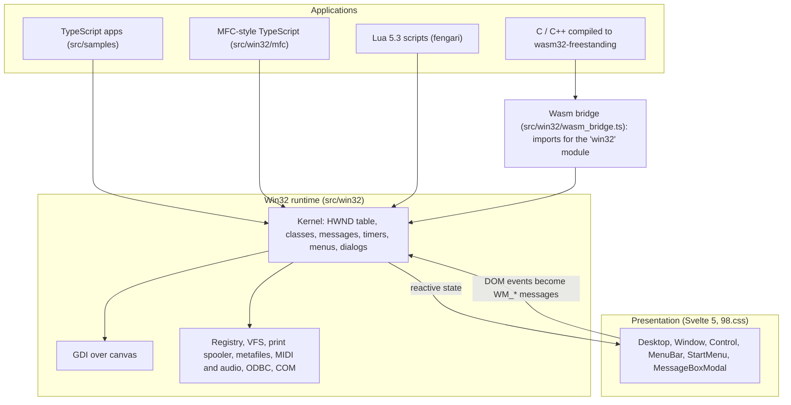

# win32-svelte

A browser implementation of a subset of the Win32 API, written in TypeScript on Svelte 5 and styled with 98.css. It provides a Windows 98 style desktop, a message-driven window manager, a canvas-backed GDI, a set of supporting subsystems (registry, filesystem, printing, metafiles, MIDI, ODBC, COM), and a bridge that lets C and C++ programs compiled to freestanding WebAssembly run against it.

Demo: https://win32-svelte.vercel.app/


> "Why write modern reactive components when you can register a `WNDCLASSEX` and write a 1995-era `WndProc` switch statement in TypeScript?"

This is a prototype. It implements enough of Win32 to run its own samples and the Petzold harness described below. It is not a general Windows compatibility layer, it does not run Windows binaries, and many calls are approximations or stubs. See [Known limitations](#known-limitations) before relying on any behaviour.

Status below was last checked on 2026-11-25.

## What it is for

- Learning and teaching Win32 programming without Windows, a compiler SDK, or an emulator.
- Experimenting with compiling source-available C/C++ Win32 code to WebAssembly and running it in a browser tab, with the platform supplied by JavaScript instead of bundled into each binary.
- Exploring how a message-oriented, handle-based programming model maps onto Svelte 5 runes (`$state`, `$derived`, `$effect`).

It is not for running closed-source `.exe` files. Projects that do that (for example Boxedwine, which runs Wine on an emulated CPU and kernel) work differently and are a different tool.

## Quick start

Requirements: Node.js 24 or newer (the `engines` field in `package.json` and the CI workflow both specify 24) and npm.

```bash
git clone https://github.com/net-pilgrim/win32-svelte.git
cd win32-svelte
npm install
npm run dev
```

Open the URL Vite prints, normally `http://localhost:5173`.

| Script | Purpose |
|---|---|
| `npm run dev` | Vite dev server with hot reload |
| `npm run build` / `npm run preview` | Production build to `dist/`, and a local preview of it |
| `npm run check` | `svelte-check` and `tsc` |
| `npm test` | Runs 12 test suites in sequence (see [Testing](#testing)) |
| `npm run test:visual` | Playwright tests for the desktop shell |
| `npm run rc -- <file.rc> -o <out.ts>` | Compile a Win32 resource script |
| `npm run headers` | Regenerate the C headers in `include/` from the TypeScript constants (`headers:ci` is the CI variant) |
| `npm run build:wasm` | Build `src/wasm/sample_app.c` to Wasm; needs Zig |
| `npm run build:example` | Build `examples/simple_c_app` with `make` |
| `npm run build:mfc` | Build `examples/starter_mfc_app` with `make` |
| `npm run build:mfc-wasm` | Build the C++ MFC example `examples/mfc_wasm_app` with `make` |
| `npm run sync:wasm` | Copy built harness binaries into `public/wasm-demo/` |

Deployment: `vercel.json` configures a static Vite build with SPA routing, so the project deploys to Vercel without further setup.

## Architecture



The kernel owns the truth: windows are entries in an in-memory handle table held in Svelte runes state. The UI layer renders that state. Child controls (buttons, edits, list and tree views and so on) become DOM elements, while a window's client area for GDI drawing is a `<canvas>`.

## Writing an application

There are three ways to target the runtime.

### TypeScript, Win32 style

```typescript
import { RegisterClassEx, CreateWindowEx, ShowWindow, DefWindowProc, MessageBox } from "./win32/kernel.svelte";
import { WM_CREATE, WM_COMMAND, WS_OVERLAPPEDWINDOW, WS_VISIBLE, WS_CHILD, SW_SHOW } from "./win32/constants";

function MyWndProc(hwnd, msg, wParam, lParam) {
  switch (msg) {
    case WM_CREATE:
      CreateWindowEx(0, "BUTTON", "Click Me", WS_CHILD | WS_VISIBLE, 20, 20, 100, 26, hwnd, 101);
      return 0;
    case WM_COMMAND:
      if (wParam === 101) MessageBox(hwnd, "Hello from win32-svelte", "Notice");
      return 0;
    default:
      return DefWindowProc(hwnd, msg, wParam, lParam);
  }
}

RegisterClassEx({ className: "MyWindowClass", lpfnWndProc: MyWndProc });
const hwnd = CreateWindowEx(0, "MyWindowClass", "Sample Window", WS_OVERLAPPEDWINDOW, 100, 100, 300, 200);
ShowWindow(hwnd, SW_SHOW);
```

The whole library is importable from `src/win32/index.ts` without the desktop shell. Working examples are in `src/samples/`, and `howto-wasm.md` covers direct library use.

### TypeScript, MFC style

`src/win32/mfc/` provides `CObject`, `CCmdTarget` (message maps), `CWnd`, `CFrameWnd`, `CDialog`, `CWinApp`, `CDC`/`CPaintDC`, and wrappers for common controls. `examples/starter_mfc_app/` is a template, and `src/samples/mfc_demo.ts` is a larger example. Document/View classes and MFC toolbars and status bars are not implemented.

### C or C++ compiled to WebAssembly

Programs include the headers in `include/` (`windows.h`, `winuser.h`, `wingdi.h`, `commctrl.h`, `mmsystem.h`, `winsock.h`, `wininet.h`, `afxwin.h` and others, kept in sync with the TypeScript constants by `npm run headers`) and are compiled with Zig or Clang for `wasm32-freestanding` with no C library. Each Win32 function is declared with `import_module("win32")` and implemented in `src/win32/wasm_bridge.ts`, which provides roughly 460 import entries (counting A/W and alias variants). The module must export `WinMain` and its function table, which is how the TypeScript side calls back into C window procedures.

```bash
make -C examples/simple_c_app        # C example
make -C examples/mfc_wasm_app        # C++ MFC example
```

The Makefiles use `-target wasm32-freestanding -nostdlib -I../../include -O2`, with link flags `--no-entry --export=WinMain --export-table`. `howto-wasm.md` has the full walkthrough. A built program can be launched by double-clicking it in the Explorer sample, from the Start menu, by dragging a `.wasm` file into the Explorer window, or from a VFS path.

Because there is no libc, programs needing the C or C++ standard library (printf, malloc, STL) get only the small shims in `include/` (`stdio.h`, `string.h`, `stdlib.h`, `malloc.h`, `math.h`, `wchar.h` and similar). Larger C++ code bases would need a real libc and a different build setup, which this repository does not provide.

## Subsystem coverage

| Area | Location | What exists | Limits |
|---|---|---|---|
| Window manager | `kernel.svelte.ts` | HWND table, `RegisterClassEx`, `CreateWindowEx`, synchronous `SendMessage`, queued `PostMessage`, `SetTimer`, menus, `MessageBox`, drag and drop of files | Client and window rectangles are approximate. `AdjustWindowRectEx` and `ScreenToClient` are minimal |
| Dialogs and resources | `dialog.ts`, `src/rc/` | `.rc` compiler (lexer, preprocessor, parser, emitter, Vite plugin), `DialogBoxParam`/`CreateDialogParam`, `LoadMenu`, string tables, dialog units | Only the resource syntax the tests and samples use is covered |
| GDI | `gdi.ts` | Canvas-backed device contexts, pens and brushes, lines, rectangles, ellipses, polygons, text | Output is not pixel-exact against Windows |
| Common controls | `ui/Control.svelte` | Buttons, edit, static, combo box, progress bar, trackbar, tab, tree view, list view (report mode), status bar, SysLink | No image lists, no tree label editing, no list column reordering |
| Metafiles | `metafile_svg.ts` | EMF and WMF parsers that render to SVG, a live metafile recorder, canvas playback | Five harness programs (Emf8 to Emf12) currently fail, see below |
| Registry | `registry.ts` | `advapi32` registry over `localStorage` with an in-memory fallback, all standard hives, `.reg` import and export, a `REGEDIT` sample | Persistence is per browser profile |
| Filesystem | `vfs.ts` | Virtual drives backed by the Origin Private File System with an in-memory fallback, file import and export | Handle-based file I/O and directory enumeration are listed as open in `TODO.md` |
| Printing | `print.ts` | Print spooler model and print dialog, output through the browser's `window.print()` | In the Wasm bridge, `StartDoc`, `StartPage`, `EndPage` and `EndDoc` currently return success without doing work |
| Audio and MIDI | `audio.ts`, `midi.ts` | Synthesised system sounds with Web Audio, `midiOut*` over the `midi.js` General MIDI synthesiser | Several harness programs that use waveform recording or MCI are flagged (Record1 to Record3, TestMci); the cause has not been analysed |
| ODBC | `odbc.ts` | ODBC API surface with a Supabase REST driver, offline sample tables, an ODBC administrator sample | Needs a configured Supabase project for live data |
| COM and DCOM | `src/win32/com/` | In-memory COM, `IDispatch` automation, simulated DCOM with a `BroadcastChannel` transport | Simulated, and only partly implemented |
| Lua | `lua_engine.ts` | Lua 5.3 through `fengari-web` with Win32 bindings | |
| DOOM | `doom_runtime.ts` | `wasm-doom` running in a Win32 window | |
| Networking | `wasm_bridge.ts` | `socket`, `connect`, `send`, `recv` and WinINet entries exist | These are canned stubs, not network access. For example `recv` returns a fixed time value so that Petzold's NetTime has something to show |
| Dynamic loading | `wasm_bridge.ts` | `LoadLibrary`, `GetProcAddress` | Stubs: they return a fixed handle and a null address |
| Threads | `wasm_bridge.ts` | `_beginthread` | Simulated cooperatively with timers, not preemptive threads |

## Sample applications

The Start menu (defined in `startmenu.json`) lists Windows Explorer, Registry Editor, Notepad, Calculator, Minesweeper, GDI Paint, Control Gallery, MFC Scribble, an RC compiler demo, the ODBC Administrator, an ISQL query tool, the Lua 5.3 Command Center, DOOM, a HWND tree inspector, a WASM C application, and a selection of Petzold programs (clocks, bouncing ball, BitBlt, EMF and 16-bit metafile demos, MDI, menu and dialog demos). The sources for the TypeScript samples are in `src/samples/`, and standalone build examples live in `examples/`.

The shell can be themed through CSS variables on `StartMenu` (`--win98-menu-bg`, `--win98-menu-color`, `--win98-highlight`, `--win98-highlight-text`, `--win98-menu-disabled`, `--win98-focus-outline`, `--win98-font-family`). Its `flat` prop (default `true`) switches between flat and beveled entries, and it supports keyboard navigation.

## Petzold harness

`harness/` contains the C sources from Charles Petzold's *Programming Windows*, 5th edition (chapters 01 to 23). The programs are built to freestanding Wasm and run against this runtime as an integration test: 143 binaries are checked in under `public/wasm-demo/`, and `harness/README.md` describes the per-chapter coverage.

Headless audit (`npx tsx -r ./src/test_setup.cjs scripts/audit_wasm_apps.ts`):

- 129 of 143 programs instantiate, run `WinMain`, and create windows or issue drawing calls.
- 14 are flagged: Emf8, Emf9, Emf10, Emf11 and Emf12 fail with a divide-by-zero error, and AddSynth, Colors3, FormFeed, HexCalc, Record1, Record2, Record3, Scramble and TestMci create no window. The causes have not been analysed yet.
- "Working" here means the program ran and drew something. The audit does not compare output with real Windows, and several passing programs log unimplemented calls while they run. It is a liveness check, not a conformance test.

To rebuild the binaries you need Clang or Zig with the WebAssembly target, `wasm-ld`, GNU make and Python 3. Run `make all` in `harness/`, then `make copy-wasm-files` and `python3 scripts/generate_wasm_manifest.py`. The harness `README.md` and `Makefile` have the details. The C sources are third-party material with their own copyright notice (`harness/readme.txt`), see [Licence](#licence).

## Known limitations

1. **The message loop for Wasm programs is not a real blocking loop.** In `wasm_bridge.ts`, `GetMessageA` returns 0 immediately, `TranslateMessage` and `DispatchMessageA` are logged no-ops, and `PeekMessageA` reports `WM_QUIT` after 25 calls. `WinMain` therefore returns straight away and the TypeScript kernel dispatches messages afterwards. Programs whose logic lives in their window procedure work. Programs that do work inside the message loop, drive animation from an idle loop, or rely on nested modal loops will not behave as on Windows. TypeScript applications use an asynchronous `GetMessage` (`Promise<boolean>`) instead.
2. **Unimplemented calls usually log and continue.** A stubbed call writes a `[WASM STUB]` line to the console and returns a default value. It does not stop the program, so silent divergence is possible.
3. **Fidelity is approximate.** Text metrics come from canvas, window geometry is simplified, and drawing is not pixel-exact.
4. **Library and network calls are stubs.** See the coverage table.
5. **Coverage is limited to what the samples and harness need.** Roughly 460 functions are exposed to Wasm modules, against thousands in the real API.
6. **No full C library.** See the Wasm section above.
7. **Accelerator tables, mnemonic underlines and tab-stop navigation are only partly implemented.**

## Testing

```bash
npm test            # 12 suites in sequence
npm run test:visual # Playwright desktop-shell tests
```

`npm test` covers the VFS, print spooler, ODBC, Wasm bridge, Lua, `.rc` compiler, Start menu, MFC layer, registry, window lifecycle, metafile and MIDI suites. On a fresh clone the final MIDI suite fails with `ENOENT` for `harness/build/Chap22/BachTocc/BachTocc.wasm`, because it reads the harness build output, which is not committed. Build the harness first (for example `make -C harness chap22`) or expect that failure. The Playwright harness spec in `tests/harness.spec.ts` has the same prerequisite. `src/win32/__tests__/doom.test.ts` exists but is not part of the `npm test` chain. A CI workflow (`.github/workflows/headers.yml`) regenerates and verifies the C headers on changes under `src/win32`, `src/rc`, `include` and `scripts`.

## Repository layout

```
src/win32/            runtime: kernel, GDI, dialogs, VFS, registry, print, ODBC, MIDI, audio,
                      metafiles, Lua, DOOM, Wasm bridge
  com/                COM, automation, simulated DCOM
  mfc/                MFC-style class library
  ui/                 Svelte components for the desktop shell and controls
  __tests__/          unit tests
src/rc/               resource script compiler and Vite plugin
src/samples/          sample applications
src/wasm/             sample C app and embedding script
include/              generated Win32 C headers and libc shims
harness/              Petzold sources, build files, chapter scanner
examples/             standalone C, C++ MFC and TypeScript MFC projects
scripts/              header generator, Wasm manifest generator, headless audit
public/wasm-demo/     built harness binaries and manifest
tests/                Playwright specs
howto-wasm.md         guide to building Wasm applications
TODO.md               exploration notes and roadmap (items are checked off as done)
CHANGELOG.md          change history
```

`TODO.md` separates implemented work from open items, and also records exploratory ideas that are not planned work, such as a containerised backend for remote filesystems, sockets and process execution.

## Licence

The project is licensed under the GNU Affero General Public License v3.0 (see `LICENSE`). Windows 98 styling comes from [98.css](https://github.com/jdan/98.css) (MIT).

The Petzold sources in `harness/` carry their own copyright notice (Microsoft Corporation and Charles Petzold, 1999; see `harness/readme.txt`). They are third-party material and are not relicensed by this repository's licence. Check the original terms before redistributing them or building on them commercially.
