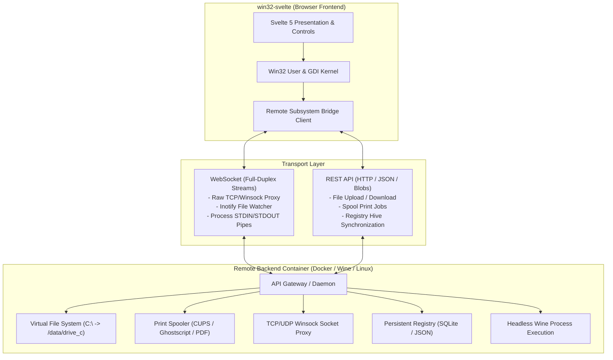

# 📋 TODO & Architectural Roadmap

This document outlines planned features, architectural milestones, and subsystem expansions for `win32-svelte`.

---

## ☁️ Remote Subsystems & Containerized Backend Architecture

Integrate a lightweight remote container (Docker / Linux daemon) communicating with the browser frontend via **REST** and **WebSockets** to elevate `win32-svelte` from an in-memory GUI sandbox to a persistent, networked cloud workstation.

---

### 1. Remote Filesystem (`kernel32.dll`)
- [ ] **Handle-Based File I/O API**:
  - `CreateFile(lpFileName, dwDesiredAccess, dwShareMode, ...)`: Proxies file open to container; returns numeric `HANDLE`.
  - `ReadFile(hFile, lpBuffer, nNumberOfBytesToRead, lpNumberOfBytesRead, ...)`: Streams byte chunks via WebSocket / binary REST chunks.
  - `WriteFile(hFile, lpBuffer, nNumberOfBytesToWrite, lpNumberOfBytesWritten, ...)`: Writes chunks to container volume.
  - `CloseHandle(hObject)`: Releases file descriptors on the backend container.
- [ ] **Directory Enumeration & Attributes**:
  - `FindFirstFile(lpFileName, lpFindFileData)` / `FindNextFile(hFindFile, lpFindFileData)`: Translates `/data/drive_c` container directory listings into `WIN32_FIND_DATA` structs.
  - `GetFileAttributes(lpFileName)` / `SetFileAttributes(lpFileName, dwFileAttributes)`.
  - `CreateDirectory(lpPathName)` / `RemoveDirectory(lpPathName)`.
- [ ] **Live Directory Change Notifications**:
  - `ReadDirectoryChangesW(...)`: Uses container `inotify` over WebSocket to push live filesystem updates directly into Windows Explorer without polling.
- [ ] **Mountable Drives**:
  - Map `(A:)` to simulated floppy disks / image uploads.
  - Map `(C:)` to container volume storage (`/var/win32/drive_c`).
  - Map `(D:)` to simulated CD-ROM ISO images.

---

### 2. Remote Printing Subsystem (`winspool.drv` & GDI Print DC)
- [ ] **GDI Printer Device Context (`CreateDC("WINSPOOL", ...)` )**:
  - Implement printer `HDC` that records GDI drawing primitives (`MoveTo`, `LineTo`, `Rectangle`, `Ellipse`, `TextOut`, fonts) into an Execution Journal / Enhanced Metafile (EMF).
- [ ] **Document Spooling Flow**:
  - `StartDoc(hdc, &docInfo)`: Initiates a new print job.
  - `StartPage(hdc)` / `EndPage(hdc)`: Delimits page boundaries.
  - `EndDoc(hdc)`: Completes the spool and packages commands for transmission.
  - `AbortDoc(hdc)`: Cancels the active spool.
- [ ] **Container Spooler Daemon**:
  - Receives GDI command streams over REST (`POST /api/spool/jobs`).
  - Rasterizes or converts commands into standard **PDF** or **PostScript** using Cairo, Ghostscript, or Puppeteer.
  - Options:
    - **Physical Print**: Routes directly to real office/home printers via **CUPS**.
    - **Virtual Print / Download**: Returns a downloadable PDF or triggers browser `window.print()` with pixel-perfect output.
- [ ] **Common Dialog Support**:
  - `PrintDlg(&pd)`: Standard Windows 98 Print configuration dialog (printer selection, page ranges, copies).

---

### 3. Winsock / Raw Networking (`ws2_32.dll`)
- [ ] **WebSocket-to-TCP/UDP Gateway**:
  - Run a lightweight TCP/UDP proxy inside the container (e.g. `websockify` or custom Node/Go proxy).
- [ ] **Socket API Implementation**:
  - `WSAStartup(wVersionRequired, &wsaData)` / `WSACleanup()`.
  - `socket(af, type, protocol)`: Opens a dedicated WebSocket stream to container daemon.
  - `connect(s, name, namelen)`: Daemon connects a real TCP socket to target host/port.
  - `send(s, buf, len, flags)` / `recv(s, buf, len, flags)`.
  - `closesocket(s)`.
- [ ] **Classic Network Sample Applications**:
  - Telnet client (`TELNET.EXE`) connecting to BBS servers.
  - IRC client (`mIRC`) connecting to real IRC networks.
  - FTP client (`FTP.EXE`) or basic HTTP browser.

---

### 4. Persistent Windows Registry (`advapi32.dll`)
- [ ] **Container Registry Database**:
  - SQLite, LevelDB, or JSON-backed persistent registry store inside the container.
- [ ] **Registry API Implementation**:
  - `RegOpenKeyEx(hKey, lpSubKey, ulOptions, samDesired, &phkResult)`.
  - `RegQueryValueEx(hKey, lpValueName, lpReserved, lpType, lpData, lpcbData)`.
  - `RegSetValueEx(hKey, lpValueName, Reserved, dwType, lpData, cbData)`.
  - `RegCloseKey(hKey)`.
- [ ] **Standard Hives**:
  - `HKEY_LOCAL_MACHINE` (`HKLM`): Machine-wide software and system settings.
  - `HKEY_CURRENT_USER` (`HKCU`): User desktop layout, icon positions, wallpaper, color themes.
  - Client-side cache to avoid round-trips for read-heavy operations.

---

### 5. Remote Process Execution & Headless Wine (`CreateProcess`)
- [ ] **Process Creation Gateway**:
  - `CreateProcess(lpApplicationName, lpCommandLine, ...)`: Proxies execution requests to a headless Wine environment running in the container.
- [ ] **Standard I/O Streams over WebSockets**:
  - Pipe container process `STDIN`, `STDOUT`, and `STDERR` over WebSockets.
- [ ] **Command Prompt Window (`cmd.exe` / `command.com`)**:
  - Terminal window inside `win32-svelte` running real MS-DOS / Win32 console binaries hosted by the container.

---

## 🪟 GUI, Common Controls & Architecture Enhancements

### 6. Common Controls 32 (`COMCTL32`) Roadmap
- [x] `SysTreeView32` (`WC_TREEVIEW`): Hierarchical tree nodes, expand/collapse, dotted lines, selection.
- [x] `SysListView32` (`WC_LISTVIEW`): Report/details mode, sticky column headers, row selection.
- [x] `SysTabControl32` (`WC_TABCONTROL`): Tabbed property sheet strips with selection switching.
- [x] `msctls_statusbar32` (`STATUSCLASSNAME`): Multi-field recessed status bar panels.
- [ ] **Image Lists (`HIMAGELIST`)**:
  - Support for `ImageList_Create`, `ImageList_Add`, and binding icons to ListView and TreeView nodes.
- [ ] **ListView Column Reordering & Sorting**:
  - Interactive header column resizing and sorting (`LVM_SORTITEMS`).
- [ ] **TreeView In-Place Label Editing**:
  - Double-click/F2 to edit node labels (`TVM_EDITLABEL`).

---

### 7. Drag & Drop and Clipboard Subsystems
- [x] **Shell Drag & Drop (`shell32.dll`)**:
  - `DragAcceptFiles`, `WM_DROPFILES`, `DragQueryFile`, `DragQueryPoint`, `DragFinish`.
  - Host OS file dropping into Notepad and Explorer.
  - In-app dragging from Explorer to Notepad and Recycle Bin.
- [ ] **System Clipboard (`user32.dll`)**:
  - `OpenClipboard(hwnd)`, `EmptyClipboard()`, `SetClipboardData(uFormat, hMem)`, `GetClipboardData(uFormat)`, `CloseClipboard()`.
  - Bridge to browser `navigator.clipboard` API for text and images.
- [ ] **OLE Structured Drag & Drop (`ole32.dll`)**:
  - `RegisterDragDrop(hwnd, pDropTarget)`.
  - `DoDragDrop(pDataObject, pDropSource, dwOKEffects, pdwEffect)`.

---

### 8. Microsoft Foundation Classes (MFC) Extensions
- [x] **Core MFC Architecture**:
  - `CObject`: RTTI, `isKindOf()`.
  - `CCmdTarget`: Command routing & Message Maps (`ON_COMMAND`, `ON_BN_CLICKED`, `ON_WM_MESSAGE`).
  - `CWnd`: Window wrapper, `FromHandle`, `attach`/`detach`, `createEx`.
  - `CFrameWnd`: Top-level SDI frame windows.
  - `CDialog`: Modal dialogs with `doModal()`, `onInitDialog()`, `onOK()`, `onCancel()`.
  - `CWinApp`: Application singleton and lifecycle (`initInstance`, `m_pMainWnd`, `run`).
  - `CDC` & `CPaintDC`: Device contexts with GDI drawing methods.
  - Controls: `CButton`, `CEdit`, `CStatic`, `CComboBox`, `CProgressCtrl`, `CSliderCtrl`, `CTreeCtrl`, `CListCtrl`.
- [ ] **Document / View Architecture**:
  - `CDocument`: Data container with `OnNewDocument()`, `OnOpenDocument()`, `Serialize()`.
  - `CView`: Base view class attached to a `CDocument` with `OnDraw(CDC* pDC)`.
  - `CDocTemplate` / `CSingleDocTemplate`: Managing document, frame, and view coordination.
- [ ] **MFC Toolbars & Statusbars**:
  - `CToolBar`: Dockable button bars with bitmap icons.
  - `CStatusBar`: Object-oriented status bar wrapper.

---

### 9. Resource Script (`.rc`) Compiler & Tooling
- [ ] **`.rc` Parser & Compiler**:
  - Parse classic `.rc` scripts:
    - `DIALOGEX` / `DIALOG` definitions (controls, coordinates, styles).
    - `MENU` / `MENUEX` structures.
    - `STRINGTABLE` localization tables.
    - `ACCELERATORS` hotkey maps.
  - Emit typed TypeScript / JSON schema objects directly executable by the kernel.
- [ ] **Dialog Box Engine**:
  - `CreateDialogParam(hInstance, lpTemplateName, hWndParent, lpDialogFunc, dwInitParam)`.
  - `DialogBoxParam(...)`: Native execution of compiled `.rc` dialog templates.

---

### 10. WebAssembly & C Compilation Target
- [ ] **C Header Bridge (`windows.h`)**:
  - Create a lightweight `windows.h` header for Emscripten / Clang that compiles native C Win32 code directly to WebAssembly and links against this JavaScript/Svelte kernel!
- [ ] **Native C Transpilation**:
  - Pipeline to take TypeScript `win32-svelte` applications and emit clean C99 code targetable by GCC or MSVC.
