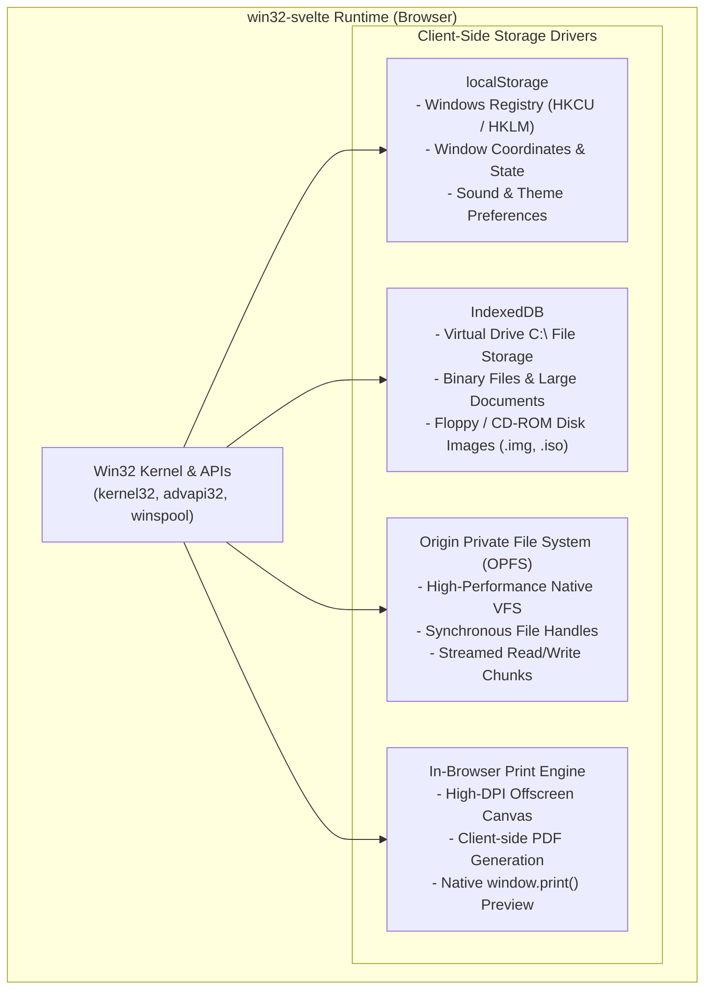
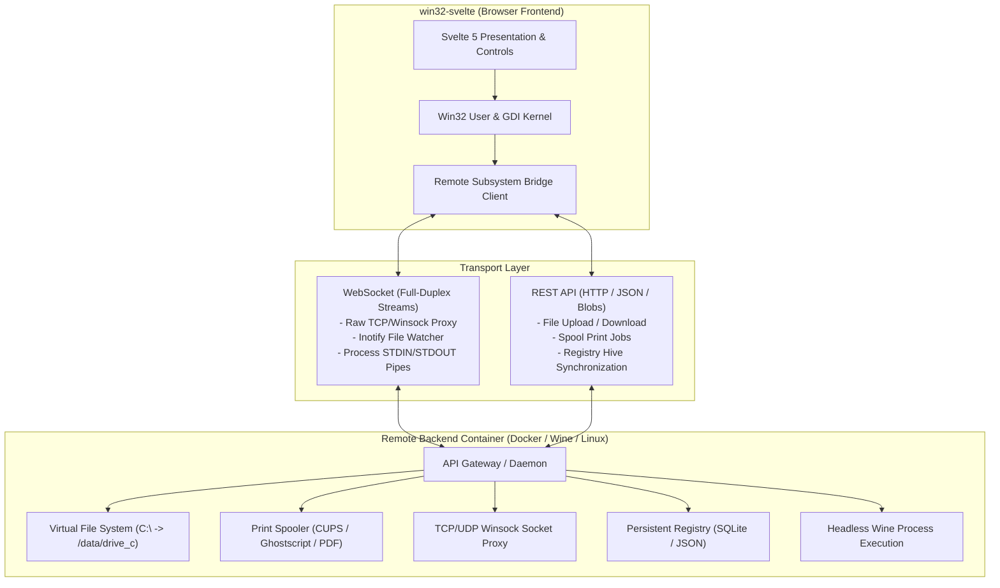

# 📋 TODO & Architectural Roadmap

This document outlines planned features, architectural milestones, and subsystem expansions for `win32-svelte`.

---

## 💾 Client-Side Storage & Offline-First Subsystems (Zero-Backend)

A tremendous amount of authentic OS functionality can be achieved entirely in-browser using standard **`localStorage`**, **`IndexedDB`**, and the modern **Origin Private File System (OPFS)**. This gives `win32-svelte` persistent, offline-capable storage with zero server requirements.

### 1. Client-Side Persistent Filesystem (OPFS)
- [x] **Origin Private File System (OPFS & VFS Core)**:
  - Backed by W3C `navigator.storage.getDirectory()` with seamless in-memory fallback for headless/Node environments.
  - Implements full Win32 `kernel32.dll` file I/O APIs: `CreateFile`, `ReadFile`, `WriteFile`, `CloseHandle`, `SetFilePointer`, `GetFileSize`, `DeleteFile`, `MoveFile`, `CopyFile`, `CreateDirectory`, `RemoveDirectory`, `GetFileAttributes`.
  - Wildcard search: `FindFirstFile` / `FindNextFile` / `FindClose` (`*.txt`, `*.*`).
  - Pre-seeded with documents, Win32 C headers, and C sample source files (`Welcome.txt`, `sample_app.c`, `windows.h`, etc.).
  - Reactive change listeners (`vfs.addChangeListener`) automatically synchronizing open explorer windows.
- [x] **Virtual Removable Media (`A:` & `D:`)**:
  - Top-level virtual drive mapping (`A:`, `C:`, `D:`) integrated into Win32 path normalization.
- [x] **File Import & Export**:
  - Right-click / Menu in Explorer $\rightarrow$ "Export to Host" (triggers browser download).
  - Drag from host desktop into Explorer or Notepad $\rightarrow$ automatically saves into OPFS persistent sandbox.
- [x] **Application Integration**:
  - Windows Explorer (`src/samples/explorer.ts`) dynamically browses live OPFS folders, double-click navigates directories or opens files, and supports creating new folders / deleting items.
  - Notepad (`src/samples/notepad.ts`) natively opens, saves, and creates files directly to/from OPFS paths (`C:\My Documents`, etc.).

### 2. Client-Side Windows Registry (`localStorage` & `advapi32.dll`)
- [ ] **Synchronous Registry Store via `localStorage`**:
  - Because `localStorage` is synchronous, key-value lookups match the blocking semantics of `RegQueryValueEx` and `RegSetValueEx` without needing `async/await`!
  - Namespace keys by registry hive:
    - `HKCU\Control Panel\Desktop` $\rightarrow$ wallpaper, color schemes, sound effects.
    - `HKCU\Software\Microsoft\Windows\CurrentVersion\Explorer` $\rightarrow$ desktop icon positions, recent files.
    - `HKLM\Software` $\rightarrow$ installed application registrations.
- [ ] **Registry API Implementation**:
  - `RegOpenKeyEx`, `RegCloseKey`, `RegQueryValueEx`, `RegSetValueEx`, `RegDeleteValue`.
  - `RegSaveKey` / `RegRestoreKey`: Import/Export `.reg` files in classic ASCII Windows registry format.

### 3. Client-Side Printing & PDF Export (Zero-Backend)
- [x] **GDI Client-Side Spooler (`winspool.drv` & `gdi32.dll`)**:
  - `CreateDC("WINSPOOL", ...)` creates a dedicated `PrinterHDC`.
  - Spooler flow: `StartDoc`, `StartPage`, `EndPage`, `EndDoc`, `AbortDoc`.
  - High-DPI offscreen page canvases with pagination, headers, footers, margins, and divider rules.
- [x] **Print Dialog & Browser Print Integration**:
  - `PrintDlg`: Standard Windows 98 Print configuration dialog (printer selection, copies, page range).
  - Browser Print: Automatic injection into `#win32-print-container` with `@media print` CSS stylesheet formatting pages for pixel-perfect browser printing and PDF generation via `window.print()`.
  - Print Preview: Interactive `StartPrintPreview` SDI window with page navigation, zoom in/out, and direct print trigger.
  - Full application wiring into Notepad (`File -> Print...`, `Print Preview`) and GDI Paint (`File -> Print...`, `Print Preview`).

### 4. Client-Side Web Audio Sound Synthesizer (`winmm.dll` & Web Audio API)
- [x] **Procedural Retro Sound Synthesis (`src/win32/audio.ts`)**:
  - Pure client-side Web Audio API synthesizer with zero external `.wav` files or assets.
  - Authentic procedural synthesis for Windows 98 sound schemes:
    - Critical Stop / Error (`playChord`): Minor-major chord cluster (A3, C4, E4, A4).
    - Exclamation / Warning (`playDing`): Resonant sine sweep (880 Hz to 1320 Hz).
    - Asterisk / Information (`playChime`): Ascending glockenspiel arpeggio (C5, E5, G5, C6).
    - Startup / Victory Fanfare (`playTada`): Multi-oscillator brass fanfare synth.
    - Minesweeper Explosion (`playExplosion`): Filtered white noise burst with sub-bass frequency ramp.
    - Button Click (`playClick`): High-frequency transient pulse.
- [x] **Win32 Message & System Integration**:
  - `MessageBeep(uType)` dispatcher hooked into `MessageBox` dialogs and desktop event triggers.
  - Global audio mute/unmute state toggle integrated into the Desktop HUD panel.

---

## ☁️ Remote Subsystems & Containerized Backend Architecture (Hybrid Mode)

Integrate a lightweight remote container (Docker / Linux daemon) communicating with the browser frontend via **REST** and **WebSockets** to elevate `win32-svelte` from an in-memory GUI sandbox to a persistent, networked cloud workstation.

---

### 1. Remote Filesystem (`kernel32.dll`)
- [ ] **Handle-Based File I/O API**:
  - `CreateFile(lpFileName, dwDesiredAccess, dwShareMode, ...)`: Proxies file open to container; returns numeric `HANDLE`.
  - `ReadFile(hFile, lpBuffer, nNumberOfBytesToRead, lpNumberOfBytesRead, ...)`: Streams byte chunks via WebSocket / binary REST chunks.
  - `WriteFile(hFile, lpBuffer, nNumberOfBytesToWrite, lpNumberOfBytesWritten, ...)`: Writes chunks to container volume.
  - `CloseHandle(hObject)`: Releases file descriptors on the backend container.
- [ ] **Directory Enumeration & Attributes**:
  - `FindFirstFile(lpFileName, lpFindFileData)` / `FindNextFile(hFindFile, lpFindFileData)`: Translates `/data/drive_c` container directory listings into `WIN32_FIND_DATA` structs.
  - `GetFileAttributes(lpFileName)` / `SetFileAttributes(lpFileName, dwFileAttributes)`.
  - `CreateDirectory(lpPathName)` / `RemoveDirectory(lpPathName)`.
- [ ] **Live Directory Change Notifications**:
  - `ReadDirectoryChangesW(...)`: Uses container `inotify` over WebSocket to push live filesystem updates directly into Windows Explorer without polling.
- [ ] **Mountable Drives**:
  - Map `(A:)` to simulated floppy disks / image uploads.
  - Map `(C:)` to container volume storage (`/var/win32/drive_c`).
  - Map `(D:)` to simulated CD-ROM ISO images.

---

### 2. Remote Printing Subsystem (`winspool.drv` & GDI Print DC)
- [ ] **GDI Printer Device Context (`CreateDC("WINSPOOL", ...)` )**:
  - Implement printer `HDC` that records GDI drawing primitives (`MoveTo`, `LineTo`, `Rectangle`, `Ellipse`, `TextOut`, fonts) into an Execution Journal / Enhanced Metafile (EMF).
- [ ] **Document Spooling Flow**:
  - `StartDoc(hdc, &docInfo)`: Initiates a new print job.
  - `StartPage(hdc)` / `EndPage(hdc)`: Delimits page boundaries.
  - `EndDoc(hdc)`: Completes the spool and packages commands for transmission.
  - `AbortDoc(hdc)`: Cancels the active spool.
- [ ] **Container Spooler Daemon**:
  - Receives GDI command streams over REST (`POST /api/spool/jobs`).
  - Rasterizes or converts commands into standard **PDF** or **PostScript** using Cairo, Ghostscript, or Puppeteer.
  - Options:
    - **Physical Print**: Routes directly to real office/home printers via **CUPS**.
    - **Virtual Print / Download**: Returns a downloadable PDF or triggers browser `window.print()` with pixel-perfect output.
- [ ] **Common Dialog Support**:
  - `PrintDlg(&pd)`: Standard Windows 98 Print configuration dialog (printer selection, page ranges, copies).

---

### 3. Winsock / Raw Networking (`ws2_32.dll`)
- [ ] **WebSocket-to-TCP/UDP Gateway**:
  - Run a lightweight TCP/UDP proxy inside the container (e.g. `websockify` or custom Node/Go proxy).
- [ ] **Socket API Implementation**:
  - `WSAStartup(wVersionRequired, &wsaData)` / `WSACleanup()`.
  - `socket(af, type, protocol)`: Opens a dedicated WebSocket stream to container daemon.
  - `connect(s, name, namelen)`: Daemon connects a real TCP socket to target host/port.
  - `send(s, buf, len, flags)` / `recv(s, buf, len, flags)`.
  - `closesocket(s)`.
- [ ] **Classic Network Sample Applications**:
  - Telnet client (`TELNET.EXE`) connecting to BBS servers.
  - IRC client (`mIRC`) connecting to real IRC networks.
  - FTP client (`FTP.EXE`) or basic HTTP browser.

---

### 4. Persistent Windows Registry (`advapi32.dll`)
- [ ] **Container Registry Database**:
  - SQLite, LevelDB, or JSON-backed persistent registry store inside the container.
- [ ] **Registry API Implementation**:
  - `RegOpenKeyEx(hKey, lpSubKey, ulOptions, samDesired, &phkResult)`.
  - `RegQueryValueEx(hKey, lpValueName, lpReserved, lpType, lpData, lpcbData)`.
  - `RegSetValueEx(hKey, lpValueName, Reserved, dwType, lpData, cbData)`.
  - `RegCloseKey(hKey)`.
- [ ] **Standard Hives**:
  - `HKEY_LOCAL_MACHINE` (`HKLM`): Machine-wide software and system settings.
  - `HKEY_CURRENT_USER` (`HKCU`): User desktop layout, icon positions, wallpaper, color themes.
  - Client-side cache to avoid round-trips for read-heavy operations.

---

### 5. Remote Process Execution & Headless Wine (`CreateProcess`)
- [ ] **Process Creation Gateway**:
  - `CreateProcess(lpApplicationName, lpCommandLine, ...)`: Proxies execution requests to a headless Wine environment running in the container.
- [ ] **Standard I/O Streams over WebSockets**:
  - Pipe container process `STDIN`, `STDOUT`, and `STDERR` over WebSockets.
- [ ] **Command Prompt Window (`cmd.exe` / `command.com`)**:
  - Terminal window inside `win32-svelte` running real MS-DOS / Win32 console binaries hosted by the container.

---

### 6. ODBC & Database Connectivity (`odbc32.dll` & Supabase)
- [x] **ODBC Core API Engine (`odbc32.dll`)**:
  - Classic Win32 ODBC handles and function signatures:
    - Environment & Connection: `SQLAllocHandle`, `SQLSetEnvAttr`, `SQLFreeHandle`.
    - Connection Management: `SQLConnect`, `SQLDriverConnect`, `SQLDisconnect`.
    - Statement & Query Execution: `SQLExecDirect`, `SQLPrepare`, `SQLExecute`.
    - Cursor & Result Set Navigation: `SQLFetch`, `SQLGetData`, `SQLNumResultCols`, `SQLDescribeCol`, `SQLRowCount`, `SQLGetDiagRec`.
- [x] **Supabase ODBC Driver & Cloud Bridge**:
  - Expose Supabase projects as a first-class virtual ODBC Data Source Name (DSN).
  - Map PostgreSQL queries and PostgREST endpoints to tabular ODBC cursor rowsets.
  - Connection string parsing (e.g. `DSN=Supabase;URL=https://xyz.supabase.co;Key=...;`).
  - Built-in sandbox mode with pre-seeded demo database tables (`employees`, `customers`, `orders`, `products`) for immediate offline querying.
- [x] **ODBC Data Source Administrator (`ODBCAD32.EXE` / `ODBCCP32.CPL`)**:
  - Classic Windows 98 Control Panel applet with User DSN, System DSN, Drivers, and About tabs (`SysTabControl32`).
  - "Configure Data Source" modal dialog for entering Supabase Project URL and API Key.
  - "Test Connection" button testing live connectivity with authentic Win32 dialog feedback.
- [x] **Sample Database Applications**:
  - Win32 SQL Query Analyzer / ISQL tool (`ISQL.EXE`): Multi-line SQL query editor with quick template dropdown and results rendered in dynamic `SysListView32` table.
  - Executable integration: Direct launching of `ODBCAD32.EXE` and `ISQL.EXE` from Desktop HUD panel and Windows Explorer.

---

## 🪟 GUI, Common Controls & Architecture Enhancements

### 7. Common Controls 32 (`COMCTL32`) & Standard Controls
- [x] `SysTreeView32` (`WC_TREEVIEW`): Hierarchical tree nodes, expand/collapse, dotted lines, selection, and `TVN_SELCHANGED` event routing.
- [x] `SysListView32` (`WC_LISTVIEW`): Report/details mode, sticky column headers, row selection, column insertion/deletion (`LVM_INSERTCOLUMN`, `LVM_DELETECOLUMN`), item insertion (`LVM_INSERTITEM`, `LVM_SETITEMTEXT`), and `LVN_ITEMCHANGED`.
- [x] `SysTabControl32` (`WC_TABCONTROL`): Tabbed property sheet strips with selection switching (`TCM_INSERTITEM`, `TCM_SETCURSEL`, `TCM_GETCURSEL`, `TCN_SELCHANGE`).
- [x] `msctls_statusbar32` (`STATUSCLASSNAME`): Multi-field recessed status bar panels (`SB_SETPARTS`, `SB_SETTEXT`).
- [x] `msctls_progress32` (`PROGRESS_CLASS`): Step, range, and position tracking (`PBM_SETPOS`, `PBM_SETRANGE`, `PBM_STEPIT`, `PBM_GETPOS`).
- [x] `msctls_trackbar32` (`TRACKBAR_CLASS`): Slider/trackbar controls with range limits and value scrubbing (`TBM_SETPOS`, `TBM_SETRANGE`, `TBM_GETPOS`, `WM_HSCROLL`).
- [x] `SysLink` (`WC_LINK`): Interactive hyperlink control with URL anchor navigation and `ShellExecute` dispatching.
- [x] **Standard Win32 Controls**:
  - `BUTTON`: Push buttons, default push buttons (`BS_DEFPUSHBUTTON`), checkboxes (`BS_AUTOCHECKBOX`), radio buttons (`BS_AUTORADIOBUTTON`), group boxes (`BS_GROUPBOX`), check states (`BM_GETCHECK`, `BM_SETCHECK`).
  - `EDIT`: Single-line and multiline (`ES_MULTILINE`), text selection (`EM_SETSEL`), line count (`EM_GETLINECOUNT`), text setting/retrieval (`WM_SETTEXT`, `WM_GETTEXT`).
  - `STATIC`: Static text labels, horizontal etched separator rules (`SS_ETCHEDHORZ`), and icons (`SS_ICON`).
  - `COMBOBOX`: Dropdown select lists (`CBS_DROPDOWN`, `CB_ADDSTRING`, `CB_SETCURSEL`, `CB_GETCURSEL`, `CB_GETLBTEXT`, `CBN_SELCHANGE`).
- [ ] **Image Lists (`HIMAGELIST`)**:
  - Support for `ImageList_Create`, `ImageList_Add`, and binding icons to ListView and TreeView nodes.
- [ ] **ListView Column Reordering & Sorting**:
  - Interactive header column resizing and sorting (`LVM_SORTITEMS`).
- [ ] **TreeView In-Place Label Editing**:
  - Double-click/F2 to edit node labels (`TVM_EDITLABEL`).

---

### 8. Drag & Drop, Shell & Clipboard Subsystems
- [x] **Shell Drag & Drop (`shell32.dll`)**:
  - `DragAcceptFiles`, `WM_DROPFILES`, `DragQueryFile`, `DragQueryPoint`, `DragFinish`.
  - Host OS file dropping into Notepad and Explorer.
  - In-app dragging from Explorer to Notepad and Recycle Bin.
- [x] **Shell API & Execution (`shell32.dll`)**:
  - `ShellExecute(hwnd, lpOperation, lpFile, lpParameters, lpDirectory, nShowCmd)` for web hyperlink navigation and external URL dispatching (`SE_ERR_SUCCESS`).
- [ ] **System Clipboard (`user32.dll`)**:
  - `OpenClipboard(hwnd)`, `EmptyClipboard()`, `SetClipboardData(uFormat, hMem)`, `GetClipboardData(uFormat)`, `CloseClipboard()`.
  - Bridge to browser `navigator.clipboard` API for text and images.
- [ ] **OLE Structured Drag & Drop (`ole32.dll`)**:
  - `RegisterDragDrop(hwnd, pDropTarget)`.
  - `DoDragDrop(pDataObject, pDropSource, dwOKEffects, pdwEffect)`.

---

### 9. Microsoft Foundation Classes (MFC) Extensions
- [x] **Core MFC Architecture**:
  - `CObject`: RTTI, `isKindOf()`.
  - `CCmdTarget`: Command routing & Message Maps (`ON_COMMAND`, `ON_BN_CLICKED`, `ON_WM_MESSAGE`).
  - `CWnd`: Window wrapper, `FromHandle`, `attach`/`detach`, `createEx`.
  - `CFrameWnd`: Top-level SDI frame windows.
  - `CDialog`: Modal dialogs with `doModal()`, `onInitDialog()`, `onOK()`, `onCancel()`.
  - `CWinApp`: Application singleton and lifecycle (`initInstance`, `m_pMainWnd`, `run`).
  - `CDC` & `CPaintDC`: Device contexts with GDI drawing methods.
  - Controls: `CButton`, `CEdit`, `CStatic`, `CComboBox`, `CProgressCtrl`, `CSliderCtrl`, `CTreeCtrl`, `CListCtrl`.
- [ ] **Document / View Architecture**:
  - `CDocument`: Data container with `OnNewDocument()`, `OnOpenDocument()`, `Serialize()`.
  - `CView`: Base view class attached to a `CDocument` with `OnDraw(CDC* pDC)`.
  - `CDocTemplate` / `CSingleDocTemplate`: Managing document, frame, and view coordination.
- [ ] **MFC Toolbars & Statusbars**:
  - `CToolBar`: Dockable button bars with bitmap icons.
  - `CStatusBar`: Object-oriented status bar wrapper.

---

### 10. Resource Script (`.rc`) Compiler & Tooling
- [x] **`.rc` Parser & Compiler**:
  - Parse classic `.rc` scripts:
    - `DIALOGEX` / `DIALOG` definitions (controls, coordinates, styles, font metrics).
    - `MENU` / `MENUEX` structures with nested popups and shortcuts.
    - `STRINGTABLE` localization tables.
    - `ACCELERATORS` hotkey maps.
    - Preprocessor directives (`#include`, `#define`, `#undef`, `#ifdef`, `#ifndef`).
  - Emit typed TypeScript / JSON schema objects directly executable by the kernel.
  - CLI compiler (`npm run rc -- <file.rc> -o <output.ts>`).
  - Vite build plugin (`win32RcPlugin` / `vite-plugin-win32-rc`) with direct `.rc` imports and HMR watch tracking.
- [x] **Dialog Box Engine**:
  - `CreateDialogParam(hInstance, lpTemplateName, hWndParent, lpDialogFunc, dwInitParam)`
  - `DialogBoxParam(...)`: Native execution of modal `.rc` dialog templates with owner disable/re-enable.
  - Dialog control helpers: `GetDlgItem`, `SetDlgItemText`, `GetDlgItemText`, `CheckDlgButton`, `IsDlgButtonChecked`, `SendDlgItemMessage`.
  - Resource loaders: `LoadMenu`, `LoadString`.
  - Integration with MFC `CDialog(lpszTemplateName, pParentWnd)`.

---

### 11. Developer Diagnostics & HWND Tree Inspector
- [x] **Live HWND Component Tree Inspector (`StartHwndInspector`)**:
  - Real-time window handle table inspector dynamically enumerating all top-level and child `HWND`s.
  - Visualized as a hierarchical tree via `SysTreeView32` with automatic periodic polling and state change detection.
  - Inspects window classes, parent-child relations, titles, edit values, coordinates, and visibility flags.
- [x] **Desktop Shell & Window Manager**:
  - Interactive desktop icons (My Computer, Explorer, Minesweeper, Paint, Notepad, Calculator, MFC Scribble, RC Compiler, Recycle Bin).
  - Drag-and-drop file recycling into Recycle Bin with warning/error sound feedback.
  - Taskbar with active window buttons, minimize/restore toggling, Start button, and live digital clock in system tray.
  - Top-right Debug HUD for instant application launching, sound toggling, and diagnostics.

---

### 12. WebAssembly & C Compilation Target
- [x] **C Header Bridge (`windows.h`) & WASM Runtime**:
  - Lightweight C Win32 headers (`include/windows.h`, `include/windef.h`, `include/winuser.h`, `include/wingdi.h`, `include/winbase.h`).
  - Targetable via Clang/Zig (`zig build-exe -target wasm32-freestanding`).
  - Function pointer and callback table bridge connecting WASM `__indirect_function_table` to JavaScript `WndProc` handlers.
  - Bridge runtime (`src/win32/wasm_bridge.ts`) providing User32 (`RegisterClassEx`, `CreateWindowEx`, `ShowWindow`, `DefWindowProc`, `SendMessage`, `PostMessage`, `MessageBox`, `SetWindowText`, `GetWindowText`) and GDI32 (`BeginPaint`, `EndPaint`, `Rectangle`, `Ellipse`, `TextOut`, `CreateSolidBrush`, `CreatePen`, `SelectObject`).
  - Sample native C application (`src/wasm/sample_app.c`) demonstrating buttons, state counter, GDI drawing, and message box popups.
  - Desktop integration with `WASM C App` desktop icon and Debug HUD quick-launcher.
- [ ] **Native C Transpilation**:
  - Pipeline to take TypeScript `win32-svelte` applications and emit clean C99 code targetable by GCC or MSVC.

---

### 13. Classic Gaming & WASM DOOM (`DOOM95.EXE`)
- [ ] **WASM DOOM Engine Integration**:
  - Integrate a WebAssembly DOOM engine (e.g., `wasm-doom` / `doomgeneric-wasm` / Emscripten build of Chocolate Doom/Doom95) running client-side at 60 FPS without external servers.
  - Implement a dedicated window class (`"DOOM_WNDCLASS"`) and `WndProc` lifecycle (`WM_CREATE`, `WM_DESTROY`, `WM_PAINT`).
- [ ] **GDI & Canvas Framebuffer Pipeline**:
  - Route the 320×200 / 640×400 software rendering framebuffer (`Uint8ClampedArray` / `ImageData`) directly to the window's registered canvas `HDC` via `StretchDIBits` / `putImageData`.
  - Support authentic aspect-ratio correction, scaling modes, and fullscreen toggling (`WS_MAXIMIZE` / Alt+Enter).
- [ ] **Win32 Message & Input Routing**:
  - Intercept and translate Win32 keyboard events (`WM_KEYDOWN`, `WM_KEYUP`, virtual keycodes `VK_UP`, `VK_DOWN`, `VK_LEFT`, `VK_RIGHT`, `VK_CONTROL`, `VK_SPACE`, etc.) into DOOM's input event queue.
  - Handle `WM_SETFOCUS` and `WM_KILLFOCUS` to automatically pause and resume gameplay when switching windows.
  - Optional mouse capture support (`SetCapture` / `ReleaseCapture` and `WM_MOUSEMOVE` for classic freelook/turning).
- [ ] **VFS & WAD Game Data Integration**:
  - Load the shareware `DOOM1.WAD` from the persistent OPFS virtual filesystem (`C:\GAMES\DOOM\DOOM1.WAD`).
  - Persist game saves (`DOOMSAV0.DSG` through `DOOMSAV5.DSG`) directly to OPFS so saves survive page reloads and can be inspected via Windows Explorer.
  - Support drag-and-drop custom `.WAD` files onto the DOOM window via `WM_DROPFILES`.
- [ ] **Audio & Sound Blaster Synthesis**:
  - Route DOOM's digital sound effects and OPL2/OPL3 AdLib / MIDI music to the Web Audio subsystem (`src/win32/audio.ts`).
- [ ] **Desktop & Shell Integration**:
  - Add a classic Doom desktop icon and Start Menu entry (`Start -> Programs -> Games -> DOOM`).

---

### 14. Lua 5.3 Scripting Engine & Command Center
- [x] **Lua 5.3 Embedded VM & Win32 Bindings**:
  - Full Lua 5.3 virtual machine integrated via Fengari engine (`src/win32/lua_engine.ts`).
  - Complete `win32` table exposed to Lua: `win32.MessageBox`, `win32.PlaySound`, `win32.CreateWindow`, `win32.CreateButton`, `win32.CreateEdit`, `win32.CreateStatic`, `win32.SetWindowText`, `win32.GetWindowText`, `win32.ShowWindow`, `win32.SendMessage`, `win32.PostMessage`, `win32.DefWindowProc`.
  - Custom window class registration (`win32.RegisterClass`) and window procedure dispatch (`WndProc(hwnd, msg, wp, lp)`) executed directly in Lua callbacks.
  - GDI graphics drawing from Lua: `win32.BeginPaint`, `win32.EndPaint`, `win32.Rectangle`, `win32.Ellipse`, `win32.Line`, `win32.TextOut`.
  - VFS integration: `win32.ReadFile`, `win32.WriteFile`, and direct `.lua` file association in Windows Explorer.
- [x] **"Lua 5.3 Command Center" GUI Application (`StartLuaHost`)**:
  - Retro Windows 98 script editor and interactive live execution console.
  - Pre-built demo scripts (Hello Win32 & Audio, Dynamic GUI & Buttons, Procedural GDI Art).
  - Reset VM and Clear Console actions with Run (F5) execution.
  - Desktop icon, taskbar Quick Launch button, and Start Menu entries.

