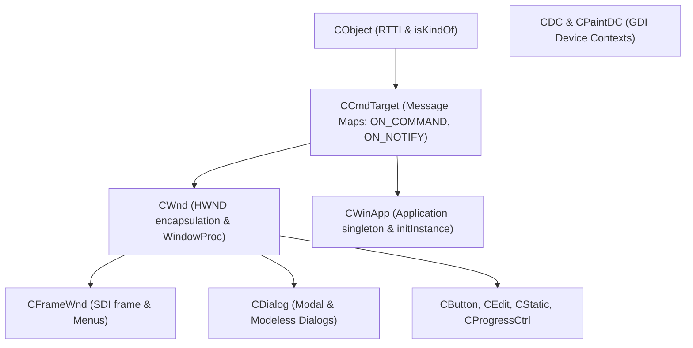

# 📐 Starter MFC Application for win32-svelte

This directory contains a complete, object-oriented **Starter MFC (Microsoft Foundation Classes)** template application designed for the `win32-svelte` sandbox.

It explores the classic 1990s Visual C++ / MFC architecture (`CWinApp`, `CFrameWnd`, `CDialog`, `CDC`, and message maps) running within the browser on top of Svelte 5 and 98.css.

---

## 📁 File Structure

```
examples/starter_mfc_app/
├── Resource.ts    # Command IDs (ID_FILE_NEW, ID_HELP_ABOUT) & Control IDs (IDC_EDIT_TEXT)
├── AboutDlg.ts    # Modal dialog box subclassed from CDialog
├── MainFrame.ts   # Top-level SDI frame window with menu, toolbar, and GDI canvas
├── App.ts         # Application object derived from CWinApp managing initInstance()
├── index.ts       # Module exports and launcher helper StartStarterMfcApp()
└── README.md      # Architecture guide and usage documentation
```

---

## 🏛️ MFC Architecture Overview

MFC organizes Win32 applications into a hierarchy of C++ (or TypeScript) classes:



### 1. `CWinApp` (The Application Object)
In MFC, every application defines a single global `CWinApp` instance. Its `initInstance()` method is called on startup to construct the main window frame and assign `m_pMainWnd`:

```typescript
export class CStarterMfcApp extends CWinApp {
  public override async initInstance(): Promise<boolean> {
    const pFrame = new CMainFrame();
    this.m_pMainWnd = pFrame;

    pFrame.create(null, "Starter MFC App", WS_OVERLAPPEDWINDOW | WS_VISIBLE, 150, 70, 440, 320);
    pFrame.showWindow();
    pFrame.updateWindow();
    return true;
  }
}
```

### 2. `CFrameWnd` (The Main Frame Window)
`CFrameWnd` represents a top-level single-document interface (SDI) window. It manages:
- **Hierarchical Menus**: Built with `CreateMenu`, `CreatePopupMenu`, `AppendMenu`, and `SetMenu`.
- **Child Controls**: Hosts `CButton`, `CEdit`, `CStatic`, `CProgressCtrl`, etc.
- **Canvas Rendering**: Set `this.setCustomProp("hasCanvas", true)` in `OnCreate()` to mount an HTML5 `<canvas>` for GDI rendering.

### 3. Message Maps (`BEGIN_MESSAGE_MAP` / `END_MESSAGE_MAP`)
Rather than giant procedural switch statements, MFC routes messages declaratively via table-driven message maps:

```typescript
protected override getMessageMap() {
  return createMessageMap(
    undefined, // Base class map supplier
    ON_WM_MESSAGE(WM_CREATE, "OnCreate"),
    ON_WM_MESSAGE(WM_PAINT, "OnPaint"),
    ON_COMMAND(ID_FILE_NEW, "OnFileNew"),
    ON_COMMAND(ID_FILE_EXIT, "OnFileExit"),
    ON_COMMAND(ID_HELP_ABOUT, "OnHelpAbout"),
    ON_BN_CLICKED(IDC_BTN_APPLY, "OnBtnApply"),
    ON_BN_CLICKED(IDC_BTN_STEP, "OnBtnStep")
  );
}
```

### 4. `CDC` & `CPaintDC` (GDI Painting)
In `OnPaint()`, constructing a `CPaintDC` automatically calls `BeginPaint` and `EndPaint` across its scope:

```typescript
public OnPaint(): void {
  const dc = new CPaintDC(this);
  if (!dc.m_hDC) return;

  // Background fill
  dc.selectStockBrush("#f0f0f0");
  dc.selectStockPen("#808080", 1);
  dc.rectangle(0, 62, w, h);

  // Geometric shapes
  dc.selectStockBrush("#000080");
  dc.rectangle(30, 80, w - 30, h - 35);

  // Styled text
  dc.setTextColor("#ffffff");
  dc.textOut(50, 100, "Rendered via MFC CPaintDC!");

  dc.dispose();
}
```

### 5. `CDialog` (Modal Dialogs)
Modal dialogs subclass `CDialog` and override `onInitDialog()`:

```typescript
export class CAboutDlg extends CDialog {
  public override onInitDialog(): boolean {
    this.setWindowText("About Starter MFC Application");
    
    // Static text controls
    this.createEx(0, "STATIC", "Starter MFC Application", WS_CHILD | WS_VISIBLE, 14, 16, 270, 20, this.m_hWnd);

    // Standard OK Button mapped to IDOK
    const btnOk = new CButton();
    btnOk.createButton("OK", WS_CHILD | WS_VISIBLE | BS_PUSHBUTTON, 115, 96, 75, 24, this, IDOK);
    return true;
  }
}
```

Invoked asynchronously from command handlers:
```typescript
public async OnHelpAbout(): Promise<void> {
  const dlg = new CAboutDlg();
  audio.playChime();
  const nResult = await dlg.doModal();
}
```

---

## 🚀 How to Launch the Starter MFC App

### 1. From TypeScript Code

```typescript
import { StartStarterMfcApp } from "./examples/starter_mfc_app";

// Launch the window at coordinates (160, 70)
const hwnd = StartStarterMfcApp(160, 70);
```

### 2. Full Application Loop (`run`)

```typescript
import { CStarterMfcApp } from "./examples/starter_mfc_app";

const app = new CStarterMfcApp();
await app.run();
```

---

## 💡 Key Differences from Visual C++ 6.0 MFC

| Feature | Classic VC++ MFC | win32-svelte MFC |
|---|---|---|
| **Language** | C++ | TypeScript (ESM) |
| **Pointers** | Raw C++ pointers (`HWND`, `CWnd*`) | Handle table numbers (`HWND`) & TS class instances |
| **Modal Loops** | Blocks thread stack in `RunModalLoop` | Asynchronous coroutine via `await dlg.doModal()` |
| **Rendering** | Windows GDI / Win32 bitmap surfaces | HTML5 2D `<canvas>` wrapped in `CDC` / `CPaintDC` |
| **Controls** | Native Win32 user32 controls | Svelte 5 reactive components styled with `98.css` |
